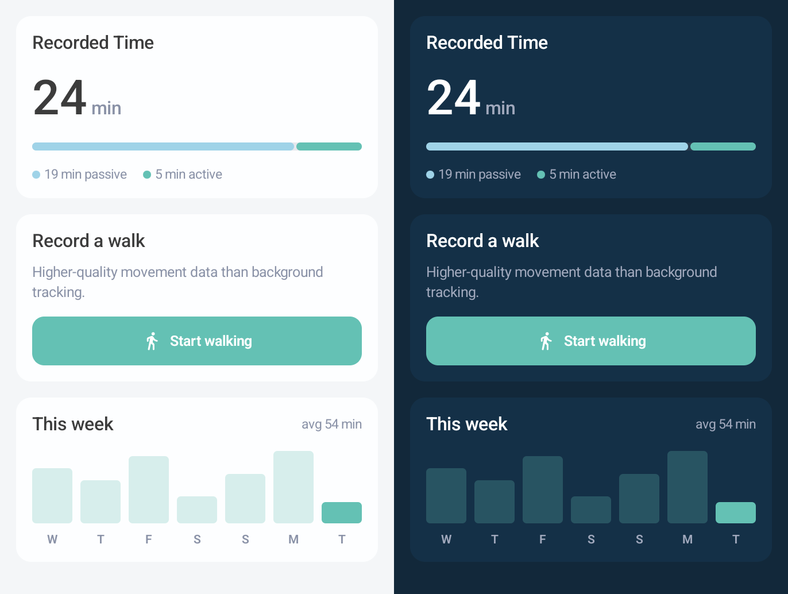

# Kinetikos Tracker SDK for Android

Add walking tracking and the 6-minute walk test to your Android app. The SDK records in the background, sends the recordings to Kinetikos, and works with **your** login: your users never see a Kinetikos screen.

> **Pre-release.** The latest version is **1.0.0-beta.7**. Everything below works today.

## How it works

```
Your server ──► Kinetikos           "P-17 takes part" · "a token for P-17, please"
Your app    ◄── your server         the token
Your app    ──► SDK ──► Kinetikos   the walking recordings, with that token
```

Your server keeps the secret credentials Kinetikos gives you and hands your app a short-lived token for the person who is signed in. Your app passes that token to the SDK. That's the whole connection.

## Before you start

- **From Kinetikos:** your tenant and client credentials for the environment you'll use (development, staging or production).
- **To Kinetikos:** your app's application ID.
- **Your app:** compiles against Android 15 (`compileSdk = 35`) or later, and runs on Android 12 (`minSdk = 31`) or later.
- **Your server:** an endpoint that returns a participant token for the signed-in user. It's three small calls; see [Your backend](docs/backend.md).

## Get it running in 5 steps

### 1. Add the dependency

In `settings.gradle.kts`, add Kinetikos' repository:

```kotlin
dependencyResolutionManagement {
    repositories {
        google()
        mavenCentral()
        maven("https://raw.githubusercontent.com/kinetikosio/tracker-sdk-android/master/maven")
    }
}
```

In your app module's `build.gradle.kts`:

```kotlin
dependencies {
    implementation("com.kinetikoshealth:tracker-sdk:1.0.0-beta.7")
}
```

### 2. Nothing to paste in the manifest

The SDK's permissions, its recording service and its receivers merge into your app on their own, and so do its shrinker rules. There is no XML to copy.

### 3. Configure it when your app starts

In your `Application` class (create one if you have none, and name it in your manifest with `android:name`):

```kotlin
class MyApp : Application() {
    override fun onCreate() {
        super.onCreate()
        // Before anything else: Android also starts your app here in the background,
        // for the SDK's own work.
        Tracker.configure(this, TrackerEnvironment.Production) { forceRefresh ->
            ParticipantTokens.fetch(forceRefresh)
        }
    }
}
```

While you test, use `TrackerEnvironment.Staging` (or `TrackerEnvironment.Custom("https://tracker-api-dev.kinetikos.io")` for development) instead of `Production`, with the credentials for that environment.

### 4. Give the SDK a token

`ParticipantTokens.fetch` above is yours to write: it asks **your server** for the signed-in person's token.

```kotlin
object ParticipantTokens {
    suspend fun fetch(forceRefresh: Boolean): String? {
        val session = MyAuth.storedSession() ?: return null                 // nobody signed in
        if (!forceRefresh) TokenCache.valid()?.let { return it }            // still good for a while
        val token = MyBackend.participantToken(session)                     // your server's token endpoint
        TokenCache.store(token)
        return token
    }
}
```

Three rules: it must work **without showing any screen** (the SDK also calls it in the background), return `null` when nobody is signed in, and fetch a fresh token when `forceRefresh` is `true`. [More about the token provider](docs/using-the-sdk.md#the-token-provider).

### 5. Ask for consent and start tracking

Nothing is recorded until the person agrees. Show the SDK's consent text with a checkbox, then ask for the permissions and start, from a coroutine on your screen (for example `rememberCoroutineScope().launch { }` or `lifecycleScope.launch { }`):

```kotlin
val document = Tracker.consentDocument(locale = Locale.getDefault().language)
// Show document.text, and a checkbox labelled document.declaration.

// When they tap "I agree":
Tracker.giveConsent(document.version, document.locale)
Tracker.requestPermissions()    // the system's "Physical activity" and notifications prompts
Tracker.startTracking()         // safe to call on every launch
```

**Done.** The SDK now records walking in the background and uploads it by itself, even when your app is closed.

One more line, when the person signs out of your app, **before** your own sign-out:

```kotlin
Tracker.signOut()
```

## Test it

Use a **real phone** (an emulator doesn't walk) and the staging or development environment. Go for a walk with the phone in your pocket: Android tells the SDK when walking starts, and the SDK records it. Open the app to trigger an upload.

## Next

- **[Screens you can copy](docs/screens.md)**: ready-made Jetpack Compose screens for consent, today's walking, the walk test, settings and results, in light and dark mode.
- **[Using the SDK](docs/using-the-sdk.md)**: the walk test, status updates, settings, sign-out, and what the SDK does by itself (revocation, withdrawal, offline).
- **[Your backend](docs/backend.md)**: the three calls your server makes, and what each answer means.
- **[Testing and going live](docs/going-live.md)**: what to declare in the Play Console, privacy, and a checklist before release.


