<!-- Generated by sdk-templates/build-screens-md.py from sdk-templates/screens.template.md
     and the files in sdk-templates/src/main/java/com/example/tracker/. Edit those, not this. -->

# Screens you can copy

[← Kinetikos Tracker SDK for Android](../README.md)

Ready-made Jetpack Compose screens and cards for what the SDK does, in the style of Kinetikos' own tracKer app. Copy the files you need into your app, then change the wording and the look to fit it ([Use your own brand](#2-use-your-own-brand)). Each block below is a whole Kotlin file, in the package `com.example.tracker`: rename it to yours. They use only the SDK's public API ([Using the SDK](using-the-sdk.md)), plus the Kinetikos endpoints that a participant token can read ([The Kinetikos API](#9-the-kinetikos-api)). The pictures show each one in light and dark mode, for a participant who has given Consent, with sample figures.

They need Material 3, the Material icons and the lifecycle Compose helpers, next to the SDK:

```kotlin
dependencies {
    implementation(platform("androidx.compose:compose-bom:2026.02.01"))
    implementation("androidx.compose.material3:material3")
    implementation("androidx.compose.material:material-icons-extended")
    implementation("androidx.activity:activity-compose:1.8.0")
    implementation("androidx.lifecycle:lifecycle-runtime-compose:2.9.4")
}
```

| File | Shows | Built on |
|---|---|---|
| `TrackerTheme.kt` | Colours, shapes and fonts; the card, button and capsule they share | — |
| `TrackerModel.kt` | Keeps what the screens show up to date | `status`, `events`, `permissions`, `recordedTime` |
| `TrackerConsentScreen.kt` | The Consent Text, the declaration to tick, then the "Physical activity" prompt | `consentDocument`, `giveConsent`, `requestPermissions`, `startTracking` |
| `TrackerNotice.kt` | A banner when nothing is being recorded, a note when Android limits background work, and a status capsule | `status.state`, `status.backgroundWork` |
| `TodayCards.kt` | Today's recorded time, a "Record a walk" card, the last seven days | `recordedTime` |
| `WalkSessionScreen.kt` | A free walk or the 6-minute walk test: countdown ring, start/stop, outcome | `startWalkTest`, `startManualRecording`, `status.recording`, `WalkTestFinished` |
| `SettingsSections.kt` | Cloud sync, permissions, consent and sign-out, a diagnostics report | `status.sync`, `syncNow`, `setAllowCellular`, `withdrawConsent`, `signOut`, `diagnostics` |
| `KinetikosApi.kt` | Reads walk-test results, About You, Gait Vitals and the week's walking time with the participant token | `GET /v1/walk-tests`, `GET`/`PUT /v1/profile/demographics`, `GET /v1/viz`, `GET /v1/stats/minutes/daily` |
| `WalkTestResultsCard.kt` | The latest walk-test results | `KinetikosApi` |
| `AboutYouSection.kt` | Date of birth, gender at birth, height and weight | `KinetikosApi` |
| `GaitVitalsCard.kt` | Yesterday's walking against the person's usual range, one point per metric | `KinetikosApi` |
| `WalkingPatternCards.kt` | When the person usually walks: by hour of the day and by day of the week | `KinetikosApi` |
| `WalkingWeekCard.kt` | The last seven days' walking time, as Kinetikos analysed it | `KinetikosApi`, `recordedTime` |
| `TrackerTabs.kt` | All of it together, in four tabs | everything above |

The recorded time on the [Today cards](#6-todays-activity-and-this-week) is counted on the phone, so it moves as soon as a walk is recorded, before upload. The cards built on `KinetikosApi` show Kinetikos' own figures, which follow uploads and analysis.

Each card that shows data comes twice: one that takes plain values, for your own data or a `@Preview`, and one that loads them (from a `TrackerModel`, or from `KinetikosApi`).

## 1. Theme

Every template reads its colours and fonts from `TrackerTheme.current`. `TrackerTheme.KinetikosLight` and `KinetikosDark` are the tracKer app's look. Wrap your Tracker screens in `ProvideTrackerTheme { }`, which also gives Material 3 components (switches, text fields, dialogs) the same colours.

```kotlin
// TrackerTheme.kt
package com.example.tracker

import android.content.Context
import android.content.Intent
import android.net.Uri
import android.provider.Settings
import androidx.compose.foundation.background
import androidx.compose.foundation.isSystemInDarkTheme
import androidx.compose.foundation.layout.Arrangement
import androidx.compose.foundation.layout.Box
import androidx.compose.foundation.layout.Column
import androidx.compose.foundation.layout.ColumnScope
import androidx.compose.foundation.layout.PaddingValues
import androidx.compose.foundation.layout.Row
import androidx.compose.foundation.layout.fillMaxWidth
import androidx.compose.foundation.layout.padding
import androidx.compose.foundation.layout.size
import androidx.compose.foundation.shape.CircleShape
import androidx.compose.foundation.shape.RoundedCornerShape
import androidx.compose.material3.Button
import androidx.compose.material3.ButtonDefaults
import androidx.compose.material3.MaterialTheme
import androidx.compose.material3.Text
import androidx.compose.material3.darkColorScheme
import androidx.compose.material3.lightColorScheme
import androidx.compose.runtime.Composable
import androidx.compose.runtime.CompositionLocalProvider
import androidx.compose.runtime.ReadOnlyComposable
import androidx.compose.runtime.staticCompositionLocalOf
import androidx.compose.ui.Alignment
import androidx.compose.ui.Modifier
import androidx.compose.ui.draw.clip
import androidx.compose.ui.draw.shadow
import androidx.compose.ui.graphics.Color
import androidx.compose.ui.text.TextStyle
import androidx.compose.ui.text.font.FontFamily
import androidx.compose.ui.text.font.FontWeight
import androidx.compose.ui.unit.Dp
import androidx.compose.ui.unit.dp
import androidx.compose.ui.unit.sp

/** How the Tracker screens look. [KinetikosLight] and [KinetikosDark] are the tracKer app's look. */
data class TrackerTheme(
    /** Buttons, switches, the walk-test ring, and active walking in charts. */
    val primary: Color,
    /** The ring while a session is recording. */
    val action: Color,
    /** Background (passive) walking in charts. */
    val passive: Color,
    val success: Color,
    val warning: Color,
    val error: Color,
    /** Behind a notice that nothing is being recorded. */
    val alert: Color,
    val screenBackground: Color,
    val cardBackground: Color,
    val text: Color,
    val secondaryText: Color,
    /** List section headers and footers. */
    val sectionTitle: Color,
    val separator: Color,
    /** Behind the Consent screen, top-start to bottom-end. */
    val heroGradient: List<Color>,
    val isDark: Boolean = false,

    val cardRadius: Dp = 15.dp,
    val controlRadius: Dp = 12.dp,

    val titleFont: TextStyle = TextStyle(fontSize = 18.sp, fontWeight = FontWeight.Medium),
    val bodyFont: TextStyle = TextStyle(fontSize = 14.sp, lineHeight = 20.sp),
    val emphasisFont: TextStyle = TextStyle(fontSize = 14.sp, fontWeight = FontWeight.Medium),
    val captionFont: TextStyle = TextStyle(fontSize = 13.sp, lineHeight = 18.sp),
    val buttonFont: TextStyle = TextStyle(fontSize = 14.sp, fontWeight = FontWeight.SemiBold),
    val numberFont: TextStyle = TextStyle(fontSize = 48.sp, fontWeight = FontWeight.Medium),
    val timerFont: TextStyle = TextStyle(fontSize = 52.sp, fontWeight = FontWeight.Light, fontFamily = FontFamily.Monospace),
) {
    companion object {
        /** The tracKer app's look, in light mode. */
        val KinetikosLight = TrackerTheme(
            primary = Color(0xFF64C1B4),
            action = Color(0xFF255986),
            passive = Color(0xFF9FD3E8),
            success = Color(0xFF45C195),
            warning = Color(0xFFFFBB7A),
            error = Color(0xFFE8587A),
            alert = Color(0xFF9E0B0F),
            screenBackground = Color(0xFFF4F6F8),
            cardBackground = Color(0xFFFDFEFF),
            text = Color(0xFF3C3C3C),
            secondaryText = Color(0xFF8A92A7),
            sectionTitle = Color(0xFF648198),
            separator = Color(0xFFC4C8D3),
            heroGradient = listOf(Color(0xFF035E96), Color(0xFF034066)),
        )

        /** The tracKer app's look, in dark mode. */
        val KinetikosDark = KinetikosLight.copy(
            action = Color(0xFF6FA8DC),
            success = Color(0xFF5ED4AA),
            warning = Color(0xFFFFCC99),
            error = Color(0xFFF07A94),
            screenBackground = Color(0xFF12283A),
            cardBackground = Color(0xFF143047),
            text = Color(0xFFFFFFFF),
            secondaryText = Color(0xFFA0A8BC),
            sectionTitle = Color(0xFF64C1B4),
            separator = Color(0xFF4A4E57),
            isDark = true,
        )

        /** The theme set by [ProvideTrackerTheme]. */
        val current: TrackerTheme
            @Composable @ReadOnlyComposable get() = LocalTrackerTheme.current
    }
}

private val LocalTrackerTheme = staticCompositionLocalOf { TrackerTheme.KinetikosLight }

/**
 * Set the look of every Tracker screen inside [content]: [light] or [dark], following
 * the system. Material 3 components (switches, text fields, dialogs) take its colours too.
 */
@Composable
fun ProvideTrackerTheme(
    light: TrackerTheme = TrackerTheme.KinetikosLight,
    dark: TrackerTheme = TrackerTheme.KinetikosDark,
    darkTheme: Boolean = isSystemInDarkTheme(),
    content: @Composable () -> Unit,
) {
    val theme = if (darkTheme) dark else light
    val base = if (darkTheme) darkColorScheme() else lightColorScheme()
    val colors = base.copy(
        primary = theme.primary,
        onPrimary = Color.White,
        secondary = theme.action,
        error = theme.error,
        background = theme.screenBackground,
        onBackground = theme.text,
        surface = theme.cardBackground,
        onSurface = theme.text,
        surfaceVariant = theme.cardBackground,
        onSurfaceVariant = theme.secondaryText,
        surfaceContainerHigh = theme.cardBackground,
        outline = theme.separator,
        outlineVariant = theme.separator,
    )
    CompositionLocalProvider(LocalTrackerTheme provides theme) {
        MaterialTheme(colorScheme = colors, content = content)
    }
}

// ---------- Shared pieces ----------

/** The rounded card behind each block, with a soft shadow. */
@Composable
fun TrackerCard(
    modifier: Modifier = Modifier,
    padding: PaddingValues = PaddingValues(16.dp),
    content: @Composable ColumnScope.() -> Unit,
) {
    val theme = TrackerTheme.current
    val shape = RoundedCornerShape(theme.cardRadius)
    Column(
        modifier = modifier
            .fillMaxWidth()
            .shadow(8.dp, shape, ambientColor = Color.Black.copy(alpha = 0.12f), spotColor = Color.Black.copy(alpha = 0.12f))
            .clip(shape)
            .background(theme.cardBackground)
            .padding(padding),
        content = content,
    )
}

/** A full-width button in the primary colour. */
@Composable
fun TrackerButton(
    text: String,
    onClick: () -> Unit,
    modifier: Modifier = Modifier,
    enabled: Boolean = true,
    color: Color = TrackerTheme.current.primary,
) {
    val theme = TrackerTheme.current
    Button(
        onClick = onClick,
        enabled = enabled,
        shape = RoundedCornerShape(theme.controlRadius),
        colors = ButtonDefaults.buttonColors(
            containerColor = color,
            contentColor = Color.White,
            disabledContainerColor = color.copy(alpha = 0.5f),
            disabledContentColor = Color.White,
        ),
        contentPadding = PaddingValues(vertical = 14.dp),
        modifier = modifier.fillMaxWidth(),
    ) {
        Text(text, style = theme.buttonFont)
    }
}

/** A coloured dot and a short label. */
@Composable
fun TrackerCapsule(text: String, color: Color, modifier: Modifier = Modifier) {
    Row(
        verticalAlignment = Alignment.CenterVertically,
        horizontalArrangement = Arrangement.spacedBy(4.dp),
        modifier = modifier
            .clip(CircleShape)
            .background(color.copy(alpha = 0.15f))
            .padding(horizontal = 12.dp, vertical = 4.dp),
    ) {
        Box(Modifier.size(8.dp).clip(CircleShape).background(color))
        Text(text, style = TextStyle(fontSize = 14.sp, fontWeight = FontWeight.Medium), color = color)
    }
}

/** The app's page in Android Settings, where the person turns permissions on. */
fun openAppSettings(context: Context) {
    context.startActivity(
        Intent(Settings.ACTION_APPLICATION_DETAILS_SETTINGS, Uri.fromParts("package", context.packageName, null))
            .addFlags(Intent.FLAG_ACTIVITY_NEW_TASK),
    )
}
```

## 2. Use your own brand

Start from the Kinetikos themes and change what differs with `copy`, or build a `TrackerTheme` from scratch. Then pass yours to `ProvideTrackerTheme`, once, at the root of your Tracker screens:

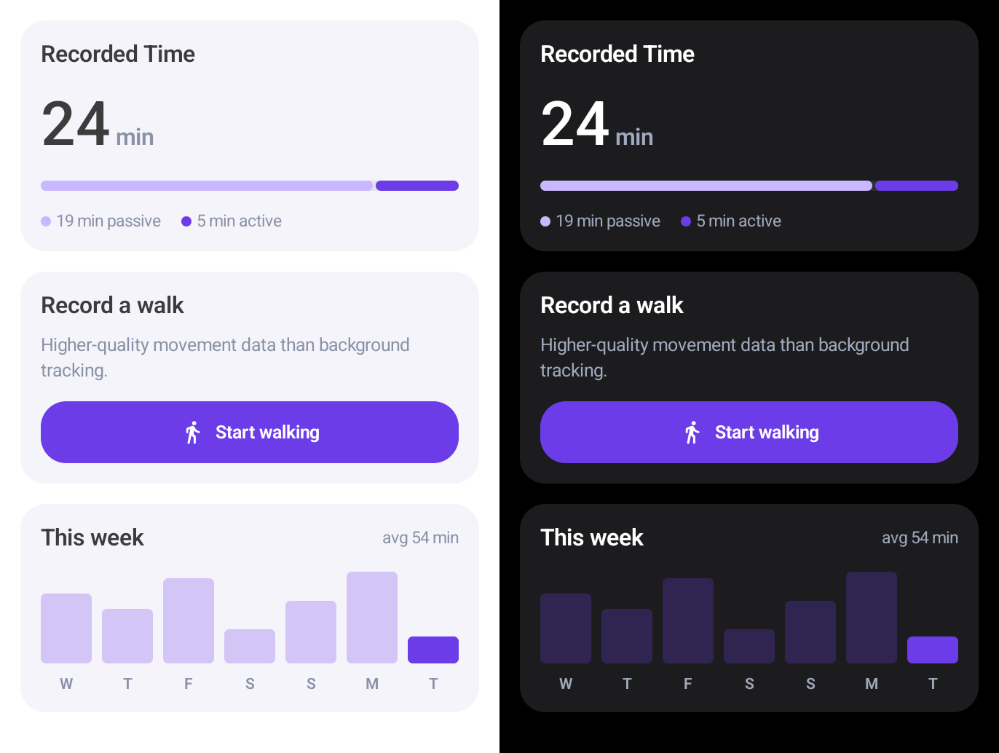

```kotlin
// MyBrand.kt
package com.example.tracker

import androidx.compose.ui.graphics.Color
import androidx.compose.ui.text.TextStyle
import androidx.compose.ui.text.font.FontWeight
import androidx.compose.ui.unit.dp
import androidx.compose.ui.unit.sp

/** A made-up brand: start from the tracKer app's look and change what differs. */
val MyBrandLight = TrackerTheme.KinetikosLight.copy(
    primary = Color(0xFF6C3CE9),
    action = Color(0xFF3B1E9A),
    passive = Color(0xFFC9B8FF),
    screenBackground = Color(0xFFFFFFFF),
    cardBackground = Color(0xFFF6F4FB),
    sectionTitle = Color(0xFF6B6B78),
    heroGradient = listOf(Color(0xFF3B1E9A), Color(0xFF1B0C4D)),
    cardRadius = 20.dp,
    controlRadius = 20.dp,
    titleFont = TextStyle(fontSize = 18.sp, fontWeight = FontWeight.SemiBold),
)

val MyBrandDark = MyBrandLight.copy(
    action = Color(0xFFA88BFF),
    screenBackground = Color(0xFF000000),
    cardBackground = Color(0xFF1C1C1E),
    text = Color(0xFFFFFFFF),
    secondaryText = Color(0xFFA0A8BC),
    sectionTitle = Color(0xFFA88BFF),
    separator = Color(0xFF4A4E57),
    isDark = true,
)

// At the root of your app:
//     ProvideTrackerTheme(light = MyBrandLight, dark = MyBrandDark) {
//         TrackerTabs(onSignOut = { ... })
//     }
```

| Token | Paints |
|---|---|
| `primary` | Buttons, switches, the walk-test ring at rest, active time in charts, "up to date" |
| `action` | The ring while recording, and status capsules while a session runs |
| `passive` | Background walking in "Recorded Time" |
| `warning`, `error`, `success` | Sync waiting, a discarded walk test or a stop button, a complete About You |
| `alert` | The banner that says nothing is being recorded |
| `screenBackground`, `cardBackground` | Behind the screens, and behind each card |
| `text`, `secondaryText`, `sectionTitle`, `separator` | Text, labels, section headers, the empty ring and outlines |
| `heroGradient` | Behind the Consent screen |
| `cardRadius`, `controlRadius` | Corners of cards, and of buttons and the mode switch |
| fonts | Card titles, body, numbers, the timer |

The wording is yours too: every string is in the template, in English. If your app is localised, move them to your string resources as you do the rest of your app. The Consent Text itself comes from the SDK, in English or Portuguese.

## 3. The model

One object follows the SDK for all the templates. Create it once, at the root of your Tracker screens, with `rememberTrackerModel()`, and pass it down (as `TrackerTabs` does in [Putting it together](#15-putting-it-together)). It refreshes the permissions and the recorded time whenever your app comes back to the foreground.

```kotlin
// TrackerModel.kt
package com.example.tracker

import androidx.compose.runtime.Composable
import androidx.compose.runtime.LaunchedEffect
import androidx.compose.runtime.remember
import androidx.compose.runtime.rememberCoroutineScope
import androidx.lifecycle.compose.LifecycleResumeEffect
import com.kinetikoshealth.tracKer.sdk.Permission
import com.kinetikoshealth.tracKer.sdk.PermissionStatus
import com.kinetikoshealth.tracKer.sdk.RecordedDay
import com.kinetikoshealth.tracKer.sdk.Tracker
import com.kinetikoshealth.tracKer.sdk.TrackerEvent
import com.kinetikoshealth.tracKer.sdk.TrackerStatus
import com.kinetikoshealth.tracKer.sdk.WalkTestOutcome
import kotlinx.coroutines.coroutineScope
import kotlinx.coroutines.flow.MutableStateFlow
import kotlinx.coroutines.flow.StateFlow
import kotlinx.coroutines.flow.asStateFlow
import kotlinx.coroutines.launch

/**
 * What the Tracker screens show, kept up to date from the SDK. Create it once, at the
 * root of your Tracker screens, with [rememberTrackerModel], and pass it down.
 */
class TrackerModel private constructor(
    private val live: Boolean,
    status: TrackerStatus?,
    permissions: List<PermissionStatus>,
    recordedDays: List<RecordedDay>,
    walkTestOutcome: WalkTestOutcome?,
    allowCellular: Boolean,
) {
    /** Follows the SDK: call [follow] to start. */
    constructor() : this(
        live = true,
        status = Tracker.status.value,
        permissions = Tracker.permissions(),
        recordedDays = emptyList(),
        walkTestOutcome = null,
        allowCellular = Tracker.allowCellular,
    )

    private val _status = MutableStateFlow(status)
    private val _permissions = MutableStateFlow(permissions)
    private val _recordedDays = MutableStateFlow(recordedDays)
    private val _walkTestOutcome = MutableStateFlow(walkTestOutcome)
    private val _allowCellular = MutableStateFlow(allowCellular)

    val status: StateFlow<TrackerStatus?> = _status.asStateFlow()
    val permissions: StateFlow<List<PermissionStatus>> = _permissions.asStateFlow()

    /** The last seven days, today last. */
    val recordedDays: StateFlow<List<RecordedDay>> = _recordedDays.asStateFlow()

    /** How the last walk test ended, until another session starts. */
    val walkTestOutcome: StateFlow<WalkTestOutcome?> = _walkTestOutcome.asStateFlow()

    /** Uploads may use mobile data. Off by default: Wi-Fi only. */
    val allowCellular: StateFlow<Boolean> = _allowCellular.asStateFlow()

    fun setAllowCellular(allow: Boolean) {
        _allowCellular.value = allow
        if (live) Tracker.setAllowCellular(allow)
    }

    /** Follow the SDK for as long as the calling coroutine runs. */
    suspend fun follow() {
        if (!live) return
        coroutineScope {
            launch { followStatus() }
            launch { followEvents() }
        }
    }

    /**
     * Re-read what may have changed while the app was away: a permission changed in
     * Android Settings, a new day.
     */
    suspend fun refresh() {
        if (!live) return
        _permissions.value = Tracker.permissions()
        _recordedDays.value = Tracker.recordedTime(days = 7)
    }

    fun startWalkTest(): Boolean {
        _walkTestOutcome.value = null
        return live && Tracker.startWalkTest()
    }

    fun startManualRecording(): Boolean {
        _walkTestOutcome.value = null
        return live && Tracker.startManualRecording()
    }

    private suspend fun followStatus() {
        Tracker.status.collect { new ->
            val old = _status.value
            _status.value = new
            _permissions.value = Tracker.permissions()
            // A new recording, or one finished: the recorded time moved.
            if (old?.sync?.pendingCount != new.sync.pendingCount || old?.recording != new.recording) {
                _recordedDays.value = Tracker.recordedTime(days = 7)
            }
        }
    }

    private suspend fun followEvents() {
        Tracker.events.collect { event ->
            if (event is TrackerEvent.WalkTestFinished) _walkTestOutcome.value = event.outcome
        }
    }

    companion object {
        /** Fixed values that don't follow the SDK, for `@Preview`s. */
        fun preview(
            status: TrackerStatus,
            recordedDays: List<RecordedDay> = emptyList(),
            permissions: List<PermissionStatus> = listOf(
                PermissionStatus(Permission.ACTIVITY_RECOGNITION, granted = true),
                PermissionStatus(Permission.NOTIFICATIONS, granted = true),
            ),
            walkTestOutcome: WalkTestOutcome? = null,
            allowCellular: Boolean = false,
        ) = TrackerModel(
            live = false,
            status = status,
            permissions = permissions,
            recordedDays = recordedDays,
            walkTestOutcome = walkTestOutcome,
            allowCellular = allowCellular,
        )
    }
}

/**
 * A [TrackerModel] that follows the SDK while it is on screen, and refreshes whenever
 * the app comes back to the foreground.
 */
@Composable
fun rememberTrackerModel(): TrackerModel {
    val model = remember { TrackerModel() }
    val scope = rememberCoroutineScope()
    LaunchedEffect(model) { model.follow() }
    LifecycleResumeEffect(model) {
        val refresh = scope.launch { model.refresh() }
        onPauseOrDispose { refresh.cancel() }
    }
    return model
}
```

## 4. Consent

The Consent Text with its declaration to tick. "I agree" records the Consent, turns tracking on and asks for "Physical activity". If the person refuses the permission, the button takes them to Android Settings, and the screen closes by itself once they come back with it on. There's no Decline: closing the screen records nothing.

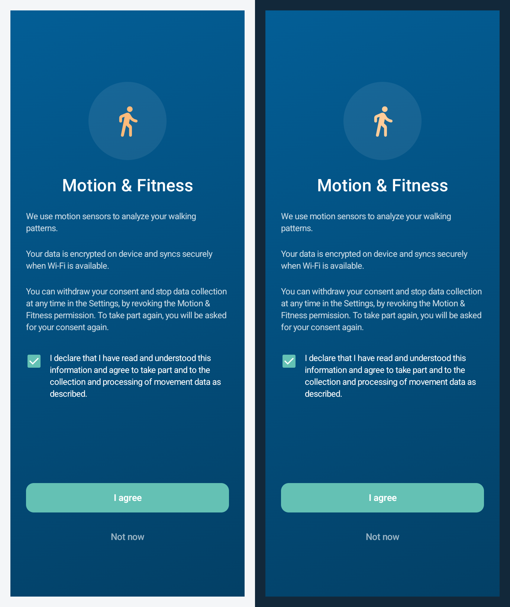

```kotlin
// TrackerConsentScreen.kt
package com.example.tracker

import androidx.compose.foundation.background
import androidx.compose.foundation.layout.Arrangement
import androidx.compose.foundation.layout.Box
import androidx.compose.foundation.layout.Column
import androidx.compose.foundation.layout.Row
import androidx.compose.foundation.layout.fillMaxSize
import androidx.compose.foundation.layout.fillMaxWidth
import androidx.compose.foundation.layout.padding
import androidx.compose.foundation.layout.size
import androidx.compose.foundation.layout.systemBarsPadding
import androidx.compose.foundation.rememberScrollState
import androidx.compose.foundation.selection.toggleable
import androidx.compose.foundation.shape.CircleShape
import androidx.compose.foundation.shape.RoundedCornerShape
import androidx.compose.foundation.verticalScroll
import androidx.compose.material.icons.Icons
import androidx.compose.material.icons.automirrored.rounded.DirectionsWalk
import androidx.compose.material3.Checkbox
import androidx.compose.material3.CheckboxDefaults
import androidx.compose.material3.Icon
import androidx.compose.material3.Text
import androidx.compose.material3.TextButton
import androidx.compose.runtime.Composable
import androidx.compose.runtime.getValue
import androidx.compose.runtime.mutableStateOf
import androidx.compose.runtime.remember
import androidx.compose.runtime.rememberCoroutineScope
import androidx.compose.runtime.saveable.rememberSaveable
import androidx.compose.runtime.setValue
import androidx.compose.ui.Alignment
import androidx.compose.ui.Modifier
import androidx.compose.ui.draw.clip
import androidx.compose.ui.graphics.Brush
import androidx.compose.ui.graphics.Color
import androidx.compose.ui.platform.LocalContext
import androidx.compose.ui.semantics.Role
import androidx.compose.ui.text.font.FontWeight
import androidx.compose.ui.unit.dp
import androidx.compose.ui.unit.sp
import androidx.lifecycle.compose.LifecycleResumeEffect
import com.kinetikoshealth.tracKer.sdk.ConsentDocument
import com.kinetikoshealth.tracKer.sdk.Permission
import com.kinetikoshealth.tracKer.sdk.PermissionStatus
import com.kinetikoshealth.tracKer.sdk.Tracker
import kotlinx.coroutines.launch
import java.util.Locale

/**
 * The Consent Text with its declaration to tick. "I agree" records the Consent, turns
 * tracking on and asks for the physical activity permission. If the person refuses it,
 * the button takes them to Android Settings, and the screen closes by itself once they
 * turn it on. There's no Decline: leaving the screen records nothing.
 *
 * [onDone]: Consent recorded and the permission granted. [onNotNow]: close without
 * consenting; null hides the button.
 */
@Composable
fun TrackerConsentScreen(
    onDone: () -> Unit,
    modifier: Modifier = Modifier,
    onNotNow: (() -> Unit)? = null,
) {
    val context = LocalContext.current
    val scope = rememberCoroutineScope()
    val document = remember { Tracker.consentDocument(Locale.getDefault().language.ifEmpty { "en" }) }
    var agreed by rememberSaveable { mutableStateOf(false) }
    var saving by remember { mutableStateOf(false) }
    var motionDenied by rememberSaveable { mutableStateOf(false) }
    var problem by rememberSaveable { mutableStateOf<String?>(null) }

    // Back from Android Settings with the permission on.
    LifecycleResumeEffect(motionDenied) {
        if (motionDenied && motionGranted(Tracker.permissions())) onDone()
        onPauseOrDispose {}
    }

    fun agree() {
        if (motionDenied) {
            openAppSettings(context)
            return
        }
        scope.launch {
            saving = true
            try {
                if (Tracker.giveConsent(document.version, document.locale).isFailure) {
                    // Your token provider returned no token: nobody is signed in.
                    problem = "Couldn't record your consent. Make sure you're signed in, then try again."
                    return@launch
                }
                // Remembered across launches; records once the permission allows it.
                Tracker.startTracking()
                // Notifications are optional: only physical activity is needed.
                if (motionGranted(Tracker.requestPermissions())) {
                    onDone()
                } else {
                    motionDenied = true
                    problem = "Physical activity access is needed to record your walking. Turn it on in Settings, under Permissions."
                }
            } finally {
                saving = false
            }
        }
    }

    TrackerConsentScreen(
        document = document,
        agreed = agreed,
        onAgreedChange = { agreed = it },
        onAgree = { agree() },
        modifier = modifier,
        saving = saving,
        motionDenied = motionDenied,
        problem = problem,
        onNotNow = onNotNow,
    )
}

/**
 * The Consent screen as plain values, for previews: [document] from
 * `Tracker.consentDocument`, and [motionDenied] turns "I agree" into "Open Settings".
 */
@Composable
fun TrackerConsentScreen(
    document: ConsentDocument,
    agreed: Boolean,
    onAgreedChange: (Boolean) -> Unit,
    onAgree: () -> Unit,
    modifier: Modifier = Modifier,
    saving: Boolean = false,
    motionDenied: Boolean = false,
    problem: String? = null,
    onNotNow: (() -> Unit)? = null,
) {
    val theme = TrackerTheme.current
    Column(
        modifier = modifier
            .fillMaxSize()
            .background(Brush.linearGradient(theme.heroGradient))
            .systemBarsPadding()
            .padding(horizontal = 24.dp),
        verticalArrangement = Arrangement.spacedBy(24.dp),
    ) {
        Column(
            modifier = Modifier
                .weight(1f)
                .verticalScroll(rememberScrollState()),
            horizontalAlignment = Alignment.CenterHorizontally,
            verticalArrangement = Arrangement.spacedBy(24.dp),
        ) {
            Box(
                modifier = Modifier
                    .padding(top = 32.dp)
                    .size(120.dp)
                    .clip(CircleShape)
                    .background(Color.White.copy(alpha = 0.08f)),
                contentAlignment = Alignment.Center,
            ) {
                Icon(
                    Icons.AutoMirrored.Rounded.DirectionsWalk,
                    contentDescription = null,
                    tint = theme.warning,
                    modifier = Modifier.size(52.dp),
                )
            }

            Text("Motion & Fitness", fontSize = 26.sp, fontWeight = FontWeight.Medium, color = Color.White)

            document.text.split("\n\n").forEach { paragraph ->
                Text(
                    paragraph,
                    style = theme.captionFont,
                    color = Color.White.copy(alpha = 0.8f),
                    modifier = Modifier.fillMaxWidth(),
                )
            }

            ConsentCheckbox(document.declaration, agreed, onAgreedChange)
        }

        Column(
            modifier = Modifier
                .fillMaxWidth()
                .padding(bottom = 32.dp),
            horizontalAlignment = Alignment.CenterHorizontally,
            verticalArrangement = Arrangement.spacedBy(12.dp),
        ) {
            if (problem != null) {
                Text(problem, style = theme.captionFont, color = Color.White)
            }
            TrackerButton(
                text = if (motionDenied) "Open Settings" else "I agree",
                onClick = onAgree,
                enabled = agreed && !saving,
            )
            if (onNotNow != null) {
                TextButton(onClick = onNotNow) {
                    Text("Not now", style = theme.emphasisFont, color = Color.White.copy(alpha = 0.6f))
                }
            }
        }
    }
}

/** A checkbox in front of the declaration; the whole row toggles it. */
@Composable
private fun ConsentCheckbox(declaration: String, checked: Boolean, onCheckedChange: (Boolean) -> Unit) {
    val theme = TrackerTheme.current
    Row(
        horizontalArrangement = Arrangement.spacedBy(12.dp),
        verticalAlignment = Alignment.Top,
        modifier = Modifier
            .fillMaxWidth()
            .clip(RoundedCornerShape(theme.controlRadius))
            .toggleable(value = checked, role = Role.Checkbox, onValueChange = onCheckedChange)
            .padding(vertical = 8.dp),
    ) {
        Checkbox(
            checked = checked,
            onCheckedChange = null,
            colors = CheckboxDefaults.colors(
                checkedColor = theme.primary,
                uncheckedColor = Color.White.copy(alpha = 0.6f),
                checkmarkColor = Color.White,
            ),
        )
        Text(declaration, style = theme.captionFont, color = Color.White, modifier = Modifier.weight(1f))
    }
}

private fun motionGranted(permissions: List<PermissionStatus>): Boolean =
    permissions.any { it.permission == Permission.ACTIVITY_RECOGNITION && it.granted }
```

## 5. Notice and status capsule

`TrackerNotice` says why nothing is being recorded, with the one thing the person can do about it, and shows nothing while all is well. When Android limits the app's background work (`status.backgroundWork`), it shows a softer note instead: walks are then recorded only while the app is open, or late. Put it at the top of your main screen. `TrackerStatusBadge` is a capsule for a header.

Android can't tell a permission that was never asked for from one that was refused, so the notice remembers a refusal, and then sends the person to Android Settings instead of asking again.

```kotlin
// TrackerNotice.kt
package com.example.tracker

import androidx.compose.foundation.background
import androidx.compose.foundation.clickable
import androidx.compose.foundation.layout.Arrangement
import androidx.compose.foundation.layout.Column
import androidx.compose.foundation.layout.Row
import androidx.compose.foundation.layout.fillMaxWidth
import androidx.compose.foundation.layout.padding
import androidx.compose.foundation.layout.size
import androidx.compose.foundation.shape.CircleShape
import androidx.compose.foundation.shape.RoundedCornerShape
import androidx.compose.material.icons.Icons
import androidx.compose.material.icons.rounded.BatteryAlert
import androidx.compose.material.icons.rounded.WarningAmber
import androidx.compose.material3.Icon
import androidx.compose.material3.Text
import androidx.compose.runtime.Composable
import androidx.compose.runtime.LaunchedEffect
import androidx.compose.runtime.collectAsState
import androidx.compose.runtime.getValue
import androidx.compose.runtime.mutableStateOf
import androidx.compose.runtime.rememberCoroutineScope
import androidx.compose.runtime.saveable.rememberSaveable
import androidx.compose.runtime.setValue
import androidx.compose.ui.Modifier
import androidx.compose.ui.draw.clip
import androidx.compose.ui.graphics.Color
import androidx.compose.ui.platform.LocalContext
import androidx.compose.ui.semantics.Role
import androidx.compose.ui.semantics.semantics
import androidx.compose.ui.text.font.FontWeight
import androidx.compose.ui.unit.dp
import com.kinetikoshealth.tracKer.sdk.Permission
import com.kinetikoshealth.tracKer.sdk.Tracker
import com.kinetikoshealth.tracKer.sdk.TrackerStatus
import com.kinetikoshealth.tracKer.sdk.TrackerStatus.State
import kotlinx.coroutines.launch

/**
 * Why nothing is being recorded, with the one thing the person can do about it, and
 * nothing while all is well. Put it at the top of your main screen. When tracking
 * runs but Android limits the app in the background, a softer note says so instead.
 *
 * [onGiveConsent]: show [TrackerConsentScreen].
 */
@Composable
fun TrackerNotice(
    model: TrackerModel,
    onGiveConsent: () -> Unit,
    modifier: Modifier = Modifier,
) {
    val context = LocalContext.current
    val scope = rememberCoroutineScope()
    val status by model.status.collectAsState()
    // Android can't say whether the prompt would still show, so remember a refusal:
    // after it, the button leads to Settings instead.
    var motionRefused by rememberSaveable { mutableStateOf(false) }
    LaunchedEffect(status?.state) {
        if (status?.state != State.NEEDS_PERMISSIONS) motionRefused = false
    }

    TrackerNotice(
        status = status,
        onGiveConsent = onGiveConsent,
        onAllowMotion = {
            scope.launch {
                val permissions = Tracker.requestPermissions()
                motionRefused = permissions.none { it.permission == Permission.ACTIVITY_RECOGNITION && it.granted }
                model.refresh()
            }
        },
        onStartTracking = { Tracker.startTracking() },
        onOpenSettings = { openAppSettings(context) },
        modifier = modifier,
        motionRefused = motionRefused,
    )
}

/**
 * The notice as plain values, for previews. [motionRefused]: the person already
 * refused the permission, so the notice points to Android Settings.
 */
@Composable
fun TrackerNotice(
    status: TrackerStatus?,
    onGiveConsent: () -> Unit,
    onAllowMotion: () -> Unit,
    onStartTracking: () -> Unit,
    onOpenSettings: () -> Unit,
    modifier: Modifier = Modifier,
    motionRefused: Boolean = false,
) {
    if (status == null || status.state == State.NOT_CONFIGURED) return
    val notice = when (status.state) {
        State.NEEDS_CONSENT -> TrackerNoticeContent(
            "Movement tracking is off",
            "Give your consent to start recording your walking.",
            "Give consent", onGiveConsent,
        )
        State.WITHDRAWN -> TrackerNoticeContent(
            "Movement tracking is paused",
            "You withdrew your consent. Movement is not recorded until you give it again.",
            "Give consent again", onGiveConsent,
        )
        State.NEEDS_PERMISSIONS -> if (motionRefused) {
            TrackerNoticeContent(
                "Movement tracking is paused",
                "Physical activity access is off for this app, so walking isn't recorded. Turn it on in Settings.",
                "Open Settings", onOpenSettings,
            )
        } else {
            TrackerNoticeContent(
                "Movement tracking is paused",
                "Allow physical activity access so your walking can be recorded.",
                "Allow", onAllowMotion,
            )
        }
        State.STOPPED -> TrackerNoticeContent(
            "Movement tracking is off",
            "Background tracking is turned off, so walking isn't recorded.",
            "Turn on", onStartTracking,
        )
        State.STUDY_INACTIVE -> TrackerNoticeContent(
            "The study isn't active at the moment",
            "Walking isn't recorded until it resumes. There's nothing you need to do.",
        )
        State.REVOKED -> TrackerNoticeContent(
            "You're no longer taking part",
            "Your walking isn't recorded any more.",
        )
        State.SIGNED_OUT -> TrackerNoticeContent(
            "You're signed out",
            "Sign in to record your walking.",
        )
        State.ACTIVE, State.NOT_CONFIGURED -> null
    }

    if (notice != null) {
        NoticeBanner(notice, modifier)
    } else {
        when (status.backgroundWork) {
            TrackerStatus.BackgroundWork.OFF -> BackgroundNote(
                "Walks are recorded only while the app is open",
                "Background use is restricted for this app. Allow it in Settings, under Battery.",
                onOpenSettings,
                modifier,
            )
            TrackerStatus.BackgroundWork.RESTRICTED -> BackgroundNote(
                "Walks may be recorded late",
                "Battery Saver is on, or Android is limiting the app because it hasn't been opened in a while.",
                null,
                modifier,
            )
            TrackerStatus.BackgroundWork.AVAILABLE -> Unit
        }
    }
}

/**
 * What is recording right now, as a capsule for a header or toolbar.
 */
@Composable
fun TrackerStatusBadge(model: TrackerModel, modifier: Modifier = Modifier) {
    val status by model.status.collectAsState()
    TrackerStatusBadge(status, modifier)
}

/** The capsule as plain values, for previews. */
@Composable
fun TrackerStatusBadge(status: TrackerStatus?, modifier: Modifier = Modifier) {
    val theme = TrackerTheme.current
    val (text, color) = when {
        status == null -> "…" to theme.secondaryText
        TrackerStatus.Recording.WALK_TEST in status.recording -> "Walk test" to theme.action
        TrackerStatus.Recording.MANUAL in status.recording -> "Recording a walk" to theme.action
        else -> when (status.state) {
            State.ACTIVE -> "Tracking walks" to theme.primary
            State.STOPPED -> "Tracking off" to theme.secondaryText
            State.SIGNED_OUT, State.NOT_CONFIGURED -> "Signed out" to theme.secondaryText
            else -> "Paused" to theme.error
        }
    }
    TrackerCapsule(text, color, modifier)
}

private class TrackerNoticeContent(
    val title: String,
    val message: String,
    val button: String? = null,
    val action: () -> Unit = {},
)

/** White on the alert colour: nothing is being recorded. */
@Composable
private fun NoticeBanner(notice: TrackerNoticeContent, modifier: Modifier) {
    val theme = TrackerTheme.current
    Column(
        modifier = modifier
            .fillMaxWidth()
            .clip(RoundedCornerShape(theme.cardRadius))
            .background(theme.alert)
            .padding(16.dp),
        verticalArrangement = Arrangement.spacedBy(8.dp),
    ) {
        Icon(Icons.Rounded.WarningAmber, contentDescription = null, tint = Color.White, modifier = Modifier.size(22.dp))
        Column(Modifier.semantics(mergeDescendants = true) {}, verticalArrangement = Arrangement.spacedBy(4.dp)) {
            Text(notice.title, style = theme.emphasisFont.copy(fontWeight = FontWeight.SemiBold), color = Color.White)
            Text(notice.message, style = theme.captionFont, color = Color.White)
        }
        if (notice.button != null) {
            Text(
                notice.button,
                style = theme.emphasisFont.copy(fontWeight = FontWeight.SemiBold),
                color = theme.alert,
                modifier = Modifier
                    .padding(top = 4.dp)
                    .clip(CircleShape)
                    .background(Color.White)
                    .clickable(role = Role.Button, onClick = notice.action)
                    .padding(horizontal = 12.dp, vertical = 6.dp),
            )
        }
    }
}

/** A card, not an alert: tracking is on, Android just holds it back. */
@Composable
private fun BackgroundNote(title: String, message: String, onOpenSettings: (() -> Unit)?, modifier: Modifier) {
    val theme = TrackerTheme.current
    TrackerCard(modifier) {
        Row(horizontalArrangement = Arrangement.spacedBy(12.dp)) {
            Icon(Icons.Rounded.BatteryAlert, contentDescription = null, tint = theme.warning, modifier = Modifier.size(22.dp))
            Column(Modifier.weight(1f), verticalArrangement = Arrangement.spacedBy(4.dp)) {
                Text(title, style = theme.emphasisFont, color = theme.text)
                Text(message, style = theme.captionFont, color = theme.secondaryText)
                if (onOpenSettings != null) {
                    Text(
                        "Open Settings",
                        style = theme.emphasisFont.copy(fontWeight = FontWeight.SemiBold),
                        color = theme.primary,
                        modifier = Modifier
                            .padding(top = 4.dp)
                            .clip(RoundedCornerShape(4.dp))
                            .clickable(role = Role.Button, onClick = onOpenSettings)
                            .padding(vertical = 4.dp),
                    )
                }
            }
        }
    }
}
```

## 6. Today's activity and this week

`RecordedTodayCard` shows today's recorded walking, split into background tracking and recorded walks or walk tests. `RecordWalkCard` leads to the walk screen. `RecordedWeekCard` shows the last seven days, with today highlighted. It needs nothing but the SDK; `WalkingWeekCard` ([Walking this week](#14-walking-this-week)) is the same card with Kinetikos' walking time.

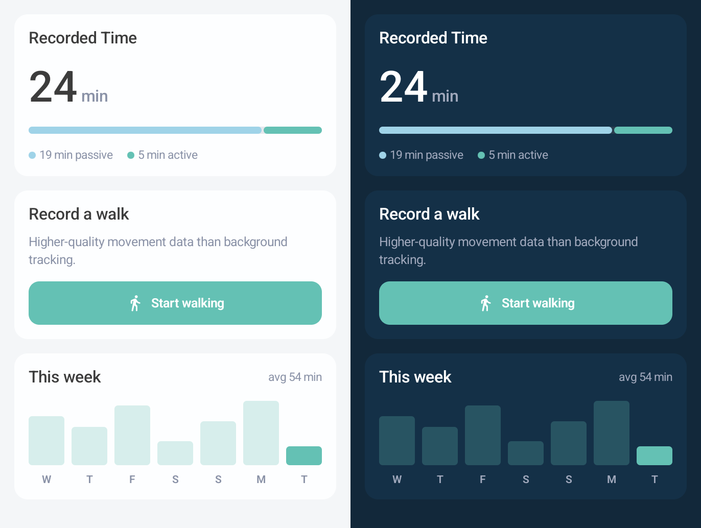

```kotlin
// TodayCards.kt
package com.example.tracker

import androidx.compose.foundation.background
import androidx.compose.foundation.layout.Arrangement
import androidx.compose.foundation.layout.Box
import androidx.compose.foundation.layout.PaddingValues
import androidx.compose.foundation.layout.Column
import androidx.compose.foundation.layout.Row
import androidx.compose.foundation.layout.Spacer
import androidx.compose.foundation.layout.fillMaxHeight
import androidx.compose.foundation.layout.fillMaxWidth
import androidx.compose.foundation.layout.height
import androidx.compose.foundation.layout.padding
import androidx.compose.foundation.layout.size
import androidx.compose.foundation.layout.width
import androidx.compose.foundation.shape.CircleShape
import androidx.compose.foundation.shape.RoundedCornerShape
import androidx.compose.material.icons.Icons
import androidx.compose.material.icons.automirrored.rounded.DirectionsWalk
import androidx.compose.material3.Button
import androidx.compose.material3.ButtonDefaults
import androidx.compose.material3.Icon
import androidx.compose.material3.Text
import androidx.compose.runtime.Composable
import androidx.compose.runtime.collectAsState
import androidx.compose.runtime.getValue
import androidx.compose.ui.Alignment
import androidx.compose.ui.Modifier
import androidx.compose.ui.draw.clip
import androidx.compose.ui.graphics.Color
import androidx.compose.ui.semantics.clearAndSetSemantics
import androidx.compose.ui.semantics.contentDescription
import androidx.compose.ui.text.font.FontWeight
import androidx.compose.ui.text.style.TextAlign
import androidx.compose.ui.unit.dp
import androidx.compose.ui.unit.sp
import com.kinetikoshealth.tracKer.sdk.RecordedDay
import java.time.LocalDate
import java.util.Locale
import kotlin.math.roundToInt
import java.time.format.TextStyle as DayNameStyle

/** Today's recorded walking, split into background tracking and recorded walks or walk tests. */
@Composable
fun RecordedTodayCard(model: TrackerModel, modifier: Modifier = Modifier) {
    val days by model.recordedDays.collectAsState()
    RecordedTodayCard(days, modifier)
}

/** The card as plain values, for previews: [days] oldest first, today last. */
@Composable
fun RecordedTodayCard(days: List<RecordedDay>, modifier: Modifier = Modifier) {
    val theme = TrackerTheme.current
    val today = days.lastOrNull()
    val total = recordedMinutes(today?.totalSeconds ?: 0)
    val active = recordedMinutes(today?.activeSeconds ?: 0)

    TrackerCard(modifier) {
        Column(verticalArrangement = Arrangement.spacedBy(16.dp)) {
            Text("Recorded Time", style = theme.titleFont, color = theme.text)

            Row(horizontalArrangement = Arrangement.spacedBy(4.dp)) {
                Text("$total", style = theme.numberFont, color = theme.text, modifier = Modifier.alignByBaseline())
                Text("min", style = theme.titleFont, color = theme.secondaryText, modifier = Modifier.alignByBaseline())
            }

            SplitBar(passive = today?.passiveSeconds ?: 0, active = today?.activeSeconds ?: 0)

            Row(horizontalArrangement = Arrangement.spacedBy(16.dp)) {
                LegendEntry(theme.passive, "${(total - active).coerceAtLeast(0)} min passive")
                LegendEntry(theme.primary, "$active min active")
            }
        }
    }
}

/** Background and active time side by side, in proportion. */
@Composable
private fun SplitBar(passive: Int, active: Int) {
    val theme = TrackerTheme.current
    Row(
        modifier = Modifier
            .fillMaxWidth()
            .height(8.dp)
            .clip(CircleShape)
            .background(theme.separator.copy(alpha = 0.4f)),
        horizontalArrangement = Arrangement.spacedBy(if (passive > 0 && active > 0) 2.dp else 0.dp),
    ) {
        // Weights must be above zero, so a part with no time is left out.
        if (passive > 0) {
            Box(Modifier.weight(passive.toFloat()).fillMaxHeight().clip(CircleShape).background(theme.passive))
        }
        if (active > 0) {
            Box(Modifier.weight(active.toFloat()).fillMaxHeight().clip(CircleShape).background(theme.primary))
        }
    }
}

@Composable
private fun LegendEntry(color: Color, text: String) {
    val theme = TrackerTheme.current
    Row(verticalAlignment = Alignment.CenterVertically, horizontalArrangement = Arrangement.spacedBy(4.dp)) {
        Box(Modifier.size(8.dp).clip(CircleShape).background(color))
        Text(text, style = theme.captionFont, color = theme.secondaryText)
    }
}

/** Leads to the walk screen ([WalkSessionScreen]) through [onStartWalking]. */
@Composable
fun RecordWalkCard(onStartWalking: () -> Unit, modifier: Modifier = Modifier) {
    val theme = TrackerTheme.current
    TrackerCard(modifier) {
        Column(verticalArrangement = Arrangement.spacedBy(12.dp)) {
            Text("Record a walk", style = theme.titleFont, color = theme.text)
            Text(
                "Higher-quality movement data than background tracking.",
                style = theme.bodyFont,
                color = theme.secondaryText,
            )
            // Not TrackerButton: this one has an icon.
            Button(
                onClick = onStartWalking,
                shape = RoundedCornerShape(theme.controlRadius),
                colors = ButtonDefaults.buttonColors(containerColor = theme.primary, contentColor = Color.White),
                contentPadding = PaddingValues(vertical = 14.dp),
                modifier = Modifier
                    .fillMaxWidth()
                    .padding(top = 4.dp),
            ) {
                Icon(Icons.AutoMirrored.Rounded.DirectionsWalk, contentDescription = null, modifier = Modifier.size(20.dp))
                Spacer(Modifier.width(8.dp))
                Text("Start walking", style = theme.buttonFont)
            }
        }
    }
}

/** The last seven days of recorded walking, today highlighted. */
@Composable
fun RecordedWeekCard(model: TrackerModel, modifier: Modifier = Modifier) {
    val days by model.recordedDays.collectAsState()
    RecordedWeekCard(days, modifier)
}

/** The card as plain values, for previews: [days] oldest first; [today] is highlighted. */
@Composable
fun RecordedWeekCard(
    days: List<RecordedDay>,
    modifier: Modifier = Modifier,
    today: LocalDate = LocalDate.now(),
) {
    val theme = TrackerTheme.current
    val plotHeight = 72.dp
    val longest = (days.maxOfOrNull { it.totalSeconds } ?: 0).coerceAtLeast(1)
    val average = if (days.isEmpty()) 0 else recordedMinutes(days.sumOf { it.totalSeconds } / days.size)
    val locale = Locale.getDefault()

    TrackerCard(modifier) {
        Column(verticalArrangement = Arrangement.spacedBy(16.dp)) {
            Row(verticalAlignment = Alignment.CenterVertically) {
                Text("This week", style = theme.titleFont, color = theme.text, modifier = Modifier.weight(1f))
                Text("avg $average min", style = theme.captionFont, color = theme.secondaryText)
            }

            Row(
                modifier = Modifier
                    .fillMaxWidth()
                    .height(plotHeight + 22.dp),
                horizontalArrangement = Arrangement.spacedBy(8.dp),
                verticalAlignment = Alignment.Bottom,
            ) {
                days.forEach { day ->
                    val isToday = day.day == today
                    val weekday = day.day.dayOfWeek.getDisplayName(DayNameStyle.FULL, locale)
                    val minutes = recordedMinutes(day.totalSeconds)
                    Column(
                        modifier = Modifier
                            .weight(1f)
                            .clearAndSetSemantics { contentDescription = "$weekday, $minutes minutes" },
                        horizontalAlignment = Alignment.CenterHorizontally,
                        verticalArrangement = Arrangement.spacedBy(4.dp),
                    ) {
                        Box(
                            Modifier
                                .fillMaxWidth()
                                .height((plotHeight * day.totalSeconds / longest).coerceAtLeast(2.dp))
                                .clip(RoundedCornerShape(4.dp))
                                .background(if (isToday) theme.primary else theme.primary.copy(alpha = 0.25f)),
                        )
                        Text(
                            day.day.dayOfWeek.getDisplayName(DayNameStyle.NARROW, locale),
                            fontSize = 12.sp,
                            fontWeight = FontWeight.SemiBold,
                            color = theme.secondaryText,
                            textAlign = TextAlign.Center,
                            modifier = Modifier.height(18.dp),
                        )
                    }
                }
            }
        }
    }
}

private fun recordedMinutes(seconds: Int): Int = (seconds / 60.0).roundToInt()
```

## 7. Walk screen

A switch between the 6-minute walk test and a free walk, a ring that counts down the test (or up, for a free walk), and one start/stop button. Stopping a test early asks first, because the test is then discarded. After a test, the screen says how it ended. Coming back to the screen mid-walk shows the session that is running. `walkTestLocked` keeps the test closed, e.g. until About You is complete.

The SDK publishes a new status every second while a walk test runs, so the countdown just follows it.

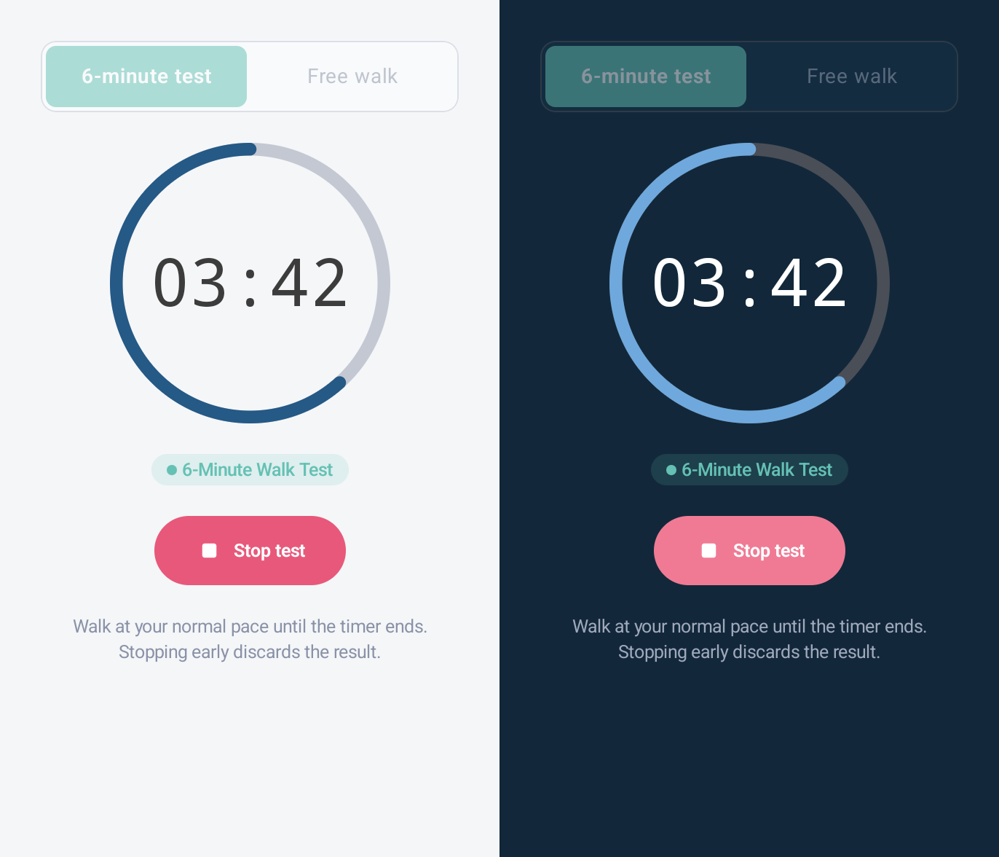

```kotlin
// WalkSessionScreen.kt
package com.example.tracker

import androidx.compose.animation.core.LinearEasing
import androidx.compose.animation.core.animateFloatAsState
import androidx.compose.animation.core.snap
import androidx.compose.animation.core.tween
import androidx.compose.foundation.Canvas
import androidx.compose.foundation.background
import androidx.compose.foundation.border
import androidx.compose.foundation.layout.Arrangement
import androidx.compose.foundation.layout.Box
import androidx.compose.foundation.layout.Column
import androidx.compose.foundation.layout.PaddingValues
import androidx.compose.foundation.layout.Row
import androidx.compose.foundation.layout.Spacer
import androidx.compose.foundation.layout.fillMaxSize
import androidx.compose.foundation.layout.fillMaxWidth
import androidx.compose.foundation.layout.padding
import androidx.compose.foundation.layout.size
import androidx.compose.foundation.layout.width
import androidx.compose.foundation.rememberScrollState
import androidx.compose.foundation.selection.selectable
import androidx.compose.foundation.selection.selectableGroup
import androidx.compose.foundation.shape.CircleShape
import androidx.compose.foundation.shape.RoundedCornerShape
import androidx.compose.foundation.verticalScroll
import androidx.compose.material.icons.Icons
import androidx.compose.material.icons.rounded.PlayArrow
import androidx.compose.material.icons.rounded.Stop
import androidx.compose.material.icons.rounded.Warning
import androidx.compose.material3.AlertDialog
import androidx.compose.material3.Button
import androidx.compose.material3.ButtonDefaults
import androidx.compose.material3.Icon
import androidx.compose.material3.Text
import androidx.compose.material3.TextButton
import androidx.compose.runtime.Composable
import androidx.compose.runtime.LaunchedEffect
import androidx.compose.runtime.collectAsState
import androidx.compose.runtime.getValue
import androidx.compose.runtime.mutableLongStateOf
import androidx.compose.runtime.mutableStateOf
import androidx.compose.runtime.remember
import androidx.compose.runtime.saveable.rememberSaveable
import androidx.compose.runtime.setValue
import androidx.compose.ui.Alignment
import androidx.compose.ui.Modifier
import androidx.compose.ui.draw.alpha
import androidx.compose.ui.draw.clip
import androidx.compose.ui.draw.shadow
import androidx.compose.ui.geometry.Offset
import androidx.compose.ui.geometry.Size
import androidx.compose.ui.graphics.Color
import androidx.compose.ui.graphics.StrokeCap
import androidx.compose.ui.graphics.drawscope.Stroke
import androidx.compose.ui.semantics.Role
import androidx.compose.ui.semantics.clearAndSetSemantics
import androidx.compose.ui.text.font.FontWeight
import androidx.compose.ui.text.style.TextAlign
import androidx.compose.ui.unit.dp
import androidx.compose.ui.unit.sp
import com.kinetikoshealth.tracKer.sdk.Permission
import com.kinetikoshealth.tracKer.sdk.Tracker
import com.kinetikoshealth.tracKer.sdk.TrackerStatus
import com.kinetikoshealth.tracKer.sdk.WalkTestOutcome
import kotlinx.coroutines.delay

/**
 * A switch between the 6-minute walk test and a free walk, a ring that counts down
 * the test (or up, for a free walk), and one start/stop button. Stopping a test early
 * asks first, because the test is then discarded. After a test, the screen says how
 * it ended. Coming back to the screen mid-walk shows the session that is running.
 *
 * [walkTestLocked]: lock the test, e.g. until About You is complete. The button still
 * works and calls [onLockedTap], so the person finds out why.
 */
@Composable
fun WalkSessionScreen(
    model: TrackerModel,
    modifier: Modifier = Modifier,
    walkTestLocked: Boolean = false,
    onLockedTap: () -> Unit = {},
) {
    val status by model.status.collectAsState()
    val outcome by model.walkTestOutcome.collectAsState()
    val permissions by model.permissions.collectAsState()
    var testMode by rememberSaveable { mutableStateOf(true) }
    var confirmStop by remember { mutableStateOf(false) }
    var couldNotStart by remember { mutableStateOf(false) }

    val recording = status?.recording.orEmpty()
    val runningTest = TrackerStatus.Recording.WALK_TEST in recording
    val running = runningTest || TrackerStatus.Recording.MANUAL in recording

    // The session already running decides the mode.
    LaunchedEffect(running, runningTest) {
        if (running) testMode = runningTest
    }

    // The test's countdown comes with each status, every second. A free walk counts
    // up from when it started, so it needs a clock of its own.
    var now by remember { mutableLongStateOf(System.currentTimeMillis()) }
    val countingUp = running && !runningTest
    LaunchedEffect(countingUp) {
        while (countingUp) {
            now = System.currentTimeMillis()
            delay(1_000)
        }
    }

    WalkSessionScreen(
        status = status,
        walkTestOutcome = outcome,
        testMode = testMode,
        onTestModeChange = { testMode = it },
        onStartOrStop = {
            when {
                runningTest -> confirmStop = true
                running -> Tracker.stopManualRecording()
                testMode && walkTestLocked -> onLockedTap()
                else -> {
                    val started = if (testMode) model.startWalkTest() else model.startManualRecording()
                    couldNotStart = !started
                }
            }
        },
        modifier = modifier,
        motionGranted = permissions.any { it.permission == Permission.ACTIVITY_RECOGNITION && it.granted },
        walkTestLocked = walkTestLocked,
        now = now,
    )

    if (confirmStop) {
        val theme = TrackerTheme.current
        AlertDialog(
            onDismissRequest = { confirmStop = false },
            title = { Text("Stop the test?") },
            text = { Text("The six minutes are not up yet. Stopping now discards this recording: nothing is saved.") },
            confirmButton = {
                TextButton(onClick = {
                    confirmStop = false
                    Tracker.stopWalkTest()
                }) { Text("Stop test", color = theme.error) }
            },
            dismissButton = {
                TextButton(onClick = { confirmStop = false }) { Text("Keep walking") }
            },
        )
    }
    if (couldNotStart) {
        AlertDialog(
            onDismissRequest = { couldNotStart = false },
            title = { Text("Couldn't start") },
            text = { Text("Check that you've given your consent and that physical activity access is on.") },
            confirmButton = {
                TextButton(onClick = { couldNotStart = false }) { Text("OK") }
            },
        )
    }
}

/**
 * The walk screen as plain values, for previews. [status] decides what is running;
 * [now] (epoch millis) times a free walk from `status.sessionStartedAt`.
 */
@Composable
fun WalkSessionScreen(
    status: TrackerStatus?,
    walkTestOutcome: WalkTestOutcome?,
    testMode: Boolean,
    onTestModeChange: (Boolean) -> Unit,
    onStartOrStop: () -> Unit,
    modifier: Modifier = Modifier,
    motionGranted: Boolean = true,
    walkTestLocked: Boolean = false,
    now: Long = System.currentTimeMillis(),
) {
    val theme = TrackerTheme.current
    val recording = status?.recording.orEmpty()
    val runningTest = TrackerStatus.Recording.WALK_TEST in recording
    val running = runningTest || TrackerStatus.Recording.MANUAL in recording

    Column(
        modifier = modifier
            .fillMaxSize()
            .background(theme.screenBackground)
            .verticalScroll(rememberScrollState())
            .padding(16.dp),
        horizontalAlignment = Alignment.CenterHorizontally,
        verticalArrangement = Arrangement.spacedBy(24.dp),
    ) {
        WalkModeSwitch(testMode, onTestModeChange, enabled = !running)

        // The ring.
        val duration = Tracker.walkTestDurationSeconds
        val elapsed = status?.sessionStartedAt?.let { ((now - it) / 1000).coerceAtLeast(0).toInt() } ?: 0
        val remaining = status?.walkTest?.remainingSeconds ?: duration
        val completed = !running && testMode && walkTestOutcome == WalkTestOutcome.COMPLETED
        val seconds = when {
            running -> if (runningTest) remaining else elapsed
            testMode && !completed -> duration
            else -> 0
        }
        WalkCountdownRing(
            progress = if (runningTest) remaining.toFloat() / duration else 1f,
            color = if (running) theme.action else theme.primary,
            halo = completed,
            animated = running,
        ) {
            WalkTimerText(seconds)
        }

        WalkStatusArea(running, runningTest, if (testMode) walkTestOutcome else null)
        WalkSessionButton(
            label = when {
                running -> if (runningTest) "Stop test" else "Stop walk"
                else -> if (testMode) "Start test" else "Start walk"
            },
            running = running,
            onClick = onStartOrStop,
        )

        Text(
            if (testMode) {
                "Walk at your normal pace until the timer ends. Stopping early discards the result."
            } else {
                "Walk for as long as you like. The session is saved when you stop."
            },
            style = theme.bodyFont,
            color = theme.secondaryText,
            textAlign = TextAlign.Center,
        )

        if (testMode && !running && walkTestLocked) {
            Text("Locked until you fill in About You.", style = theme.captionFont, color = theme.error)
        }
        if (!motionGranted) {
            Row(verticalAlignment = Alignment.CenterVertically, horizontalArrangement = Arrangement.spacedBy(6.dp)) {
                Icon(Icons.Rounded.Warning, contentDescription = null, tint = theme.warning, modifier = Modifier.size(16.dp))
                Text("Physical activity permission required", style = theme.captionFont, color = theme.warning)
            }
        }
    }
}

// ---------- Mode switch ----------

@Composable
private fun WalkModeSwitch(testMode: Boolean, onTestModeChange: (Boolean) -> Unit, enabled: Boolean) {
    val theme = TrackerTheme.current
    val shape = RoundedCornerShape(theme.controlRadius)
    Row(
        modifier = Modifier
            .fillMaxWidth()
            // Locked while a session runs: the whole switch dims.
            .alpha(if (enabled) 1f else 0.5f)
            .clip(shape)
            .background(theme.cardBackground)
            .border(1.dp, theme.separator, shape)
            .padding(4.dp)
            .selectableGroup(),
        horizontalArrangement = Arrangement.spacedBy(4.dp),
    ) {
        WalkModeSegment("6-minute test", testMode, enabled, Modifier.weight(1f)) { onTestModeChange(true) }
        WalkModeSegment("Free walk", !testMode, enabled, Modifier.weight(1f)) { onTestModeChange(false) }
    }
}

@Composable
private fun WalkModeSegment(title: String, selected: Boolean, enabled: Boolean, modifier: Modifier, onSelect: () -> Unit) {
    val theme = TrackerTheme.current
    Box(
        modifier = modifier
            .clip(RoundedCornerShape(theme.controlRadius - 4.dp))
            .background(if (selected) theme.primary else Color.Transparent)
            .selectable(selected = selected, enabled = enabled, role = Role.RadioButton, onClick = onSelect)
            .padding(vertical = 12.dp),
        contentAlignment = Alignment.Center,
    ) {
        Text(
            title,
            fontSize = 16.sp,
            fontWeight = if (selected) FontWeight.SemiBold else FontWeight.Normal,
            color = if (selected) Color.White else theme.secondaryText,
        )
    }
}

// ---------- Ring and timer ----------

/**
 * Drains counter-clockwise from twelve o'clock as the test runs. A completed test
 * gains a halo, which tells it apart from the full ring at rest.
 */
@Composable
private fun WalkCountdownRing(
    progress: Float,
    color: Color,
    halo: Boolean,
    animated: Boolean,
    content: @Composable () -> Unit,
) {
    val track = TrackerTheme.current.separator
    // The status moves in whole seconds; spreading each step over the next second
    // makes the arc slide. A stop or reset snaps.
    val shown by animateFloatAsState(
        targetValue = progress.coerceIn(0f, 1f),
        animationSpec = if (animated) tween(1_000, easing = LinearEasing) else snap(),
        label = "walkRing",
    )
    Box(Modifier.size(220.dp), contentAlignment = Alignment.Center) {
        Canvas(Modifier.fillMaxSize()) {
            val stroke = 10.dp.toPx()
            val diameter = size.minDimension - stroke
            val topLeft = Offset(stroke / 2, stroke / 2)
            val arcSize = Size(diameter, diameter)
            if (halo) {
                drawCircle(color.copy(alpha = 0.25f), radius = diameter / 2, style = Stroke(stroke * 2.4f))
            }
            drawCircle(track, radius = diameter / 2, style = Stroke(stroke))
            if (shown > 0f) {
                drawArc(
                    color = color,
                    startAngle = -90f,
                    sweepAngle = -360f * shown, // counter-clockwise
                    useCenter = false,
                    topLeft = topLeft,
                    size = arcSize,
                    style = Stroke(stroke, cap = StrokeCap.Round),
                )
            }
        }
        content()
    }
}

@Composable
private fun WalkTimerText(seconds: Int) {
    val theme = TrackerTheme.current
    val hours = seconds / 3600
    val minutes = seconds % 3600 / 60
    val secs = seconds % 60
    Text(
        if (hours > 0) "%02d:%02d:%02d".format(hours, minutes, secs) else "%02d:%02d".format(minutes, secs),
        // Smaller once there are hours, so a long free walk still fits the ring.
        style = if (hours > 0) theme.timerFont.copy(fontSize = 40.sp) else theme.timerFont,
        color = theme.text,
        maxLines = 1,
        softWrap = false,
    )
}

// ---------- Status and button ----------

@Composable
private fun WalkStatusArea(running: Boolean, runningTest: Boolean, outcome: WalkTestOutcome?) {
    val theme = TrackerTheme.current
    Box(contentAlignment = Alignment.Center) {
        // Holds the height, so the ring doesn't move when a status appears.
        TrackerCapsule("Recording", theme.primary, Modifier.alpha(0f).clearAndSetSemantics {})

        when {
            running -> TrackerCapsule(if (runningTest) "6-Minute Walk Test" else "Recording", theme.primary)
            outcome == WalkTestOutcome.COMPLETED -> Column(
                horizontalAlignment = Alignment.CenterHorizontally,
                verticalArrangement = Arrangement.spacedBy(8.dp),
            ) {
                TrackerCapsule("Finished 6-Minute Walk", theme.primary)
                Text(
                    "Your result appears a few minutes after the recording is uploaded.",
                    style = theme.captionFont,
                    color = theme.secondaryText,
                    textAlign = TextAlign.Center,
                )
            }
            outcome != null -> Text(
                when (outcome) {
                    WalkTestOutcome.STOPPED_MOVING -> "Test stopped because no movement was detected. It was not saved."
                    WalkTestOutcome.STOPPED_EARLY -> "Test stopped before six minutes. It was not saved."
                    else -> "Test was interrupted and could not be saved."
                },
                style = theme.emphasisFont,
                color = theme.error,
                textAlign = TextAlign.Center,
            )
        }
    }
}

/** Primary with a play icon at rest; red with a stop square while a session runs. */
@Composable
private fun WalkSessionButton(label: String, running: Boolean, onClick: () -> Unit) {
    val theme = TrackerTheme.current
    Button(
        onClick = onClick,
        shape = CircleShape,
        colors = ButtonDefaults.buttonColors(
            containerColor = if (running) theme.error else theme.primary,
            contentColor = Color.White,
        ),
        contentPadding = PaddingValues(horizontal = 32.dp, vertical = 16.dp),
        modifier = Modifier.shadow(4.dp, CircleShape, ambientColor = Color.Black.copy(alpha = 0.1f), spotColor = Color.Black.copy(alpha = 0.1f)),
    ) {
        Icon(if (running) Icons.Rounded.Stop else Icons.Rounded.PlayArrow, contentDescription = null, modifier = Modifier.size(22.dp))
        Spacer(Modifier.width(8.dp))
        Text(label, style = theme.buttonFont)
    }
}
```

## 8. Settings

Four sections for a settings screen: cloud sync, permissions, consent and sign-out, and a diagnostics report for your support team, which the person can share.

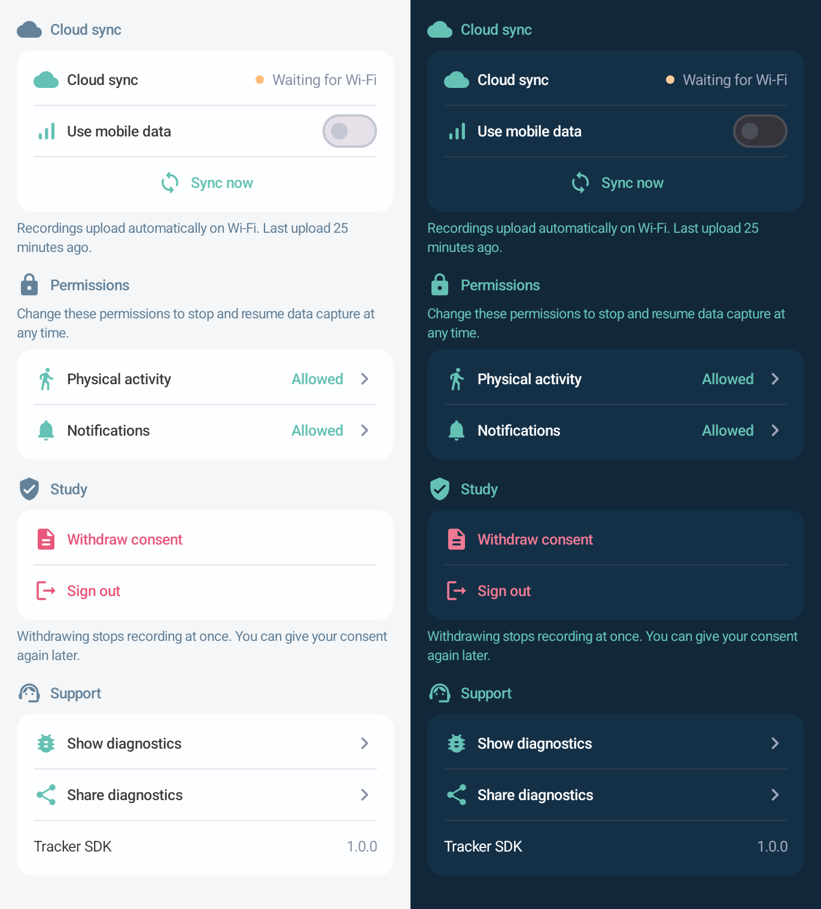

```kotlin
// SettingsSections.kt
package com.example.tracker

import android.content.Intent
import android.text.format.DateUtils
import androidx.compose.foundation.background
import androidx.compose.foundation.clickable
import androidx.compose.foundation.layout.Arrangement
import androidx.compose.foundation.layout.Box
import androidx.compose.foundation.layout.Column
import androidx.compose.foundation.layout.ColumnScope
import androidx.compose.foundation.layout.PaddingValues
import androidx.compose.foundation.layout.Row
import androidx.compose.foundation.layout.fillMaxWidth
import androidx.compose.foundation.layout.heightIn
import androidx.compose.foundation.layout.padding
import androidx.compose.foundation.layout.size
import androidx.compose.foundation.rememberScrollState
import androidx.compose.foundation.shape.CircleShape
import androidx.compose.foundation.text.selection.SelectionContainer
import androidx.compose.foundation.verticalScroll
import androidx.compose.material.icons.Icons
import androidx.compose.material.icons.automirrored.rounded.DirectionsWalk
import androidx.compose.material.icons.automirrored.rounded.KeyboardArrowRight
import androidx.compose.material.icons.automirrored.rounded.Logout
import androidx.compose.material.icons.rounded.BugReport
import androidx.compose.material.icons.rounded.Cloud
import androidx.compose.material.icons.rounded.Description
import androidx.compose.material.icons.rounded.Lock
import androidx.compose.material.icons.rounded.Notifications
import androidx.compose.material.icons.rounded.Share
import androidx.compose.material.icons.rounded.SignalCellularAlt
import androidx.compose.material.icons.rounded.SupportAgent
import androidx.compose.material.icons.rounded.Sync
import androidx.compose.material.icons.rounded.VerifiedUser
import androidx.compose.material.icons.rounded.WarningAmber
import androidx.compose.material3.AlertDialog
import androidx.compose.material3.CircularProgressIndicator
import androidx.compose.material3.HorizontalDivider
import androidx.compose.material3.Icon
import androidx.compose.material3.Switch
import androidx.compose.material3.Text
import androidx.compose.material3.TextButton
import androidx.compose.runtime.Composable
import androidx.compose.runtime.LaunchedEffect
import androidx.compose.runtime.getValue
import androidx.compose.runtime.mutableStateOf
import androidx.compose.runtime.remember
import androidx.compose.runtime.rememberCoroutineScope
import androidx.compose.runtime.setValue
import androidx.compose.ui.Alignment
import androidx.compose.ui.Modifier
import androidx.compose.ui.graphics.Color
import androidx.compose.ui.graphics.vector.ImageVector
import androidx.compose.ui.platform.LocalContext
import androidx.compose.ui.text.font.FontFamily
import androidx.compose.ui.unit.dp
import androidx.lifecycle.compose.collectAsStateWithLifecycle
import com.kinetikoshealth.tracKer.sdk.Permission
import com.kinetikoshealth.tracKer.sdk.Tracker
import com.kinetikoshealth.tracKer.sdk.TrackerStatus
import kotlinx.coroutines.launch

/** Upload status, the mobile-data switch and a "Sync now" button. */
@Composable
fun CloudSyncSection(model: TrackerModel, modifier: Modifier = Modifier) {
    val theme = TrackerTheme.current
    val status by model.status.collectAsStateWithLifecycle()
    val allowCellular by model.allowCellular.collectAsStateWithLifecycle()
    val scope = rememberCoroutineScope()
    var syncing by remember { mutableStateOf(false) }

    val sync = status?.sync
    val (stateText, stateColor) = when {
        sync == null -> "…" to theme.secondaryText
        sync.pendingCount == 0 -> "Up to date" to theme.primary
        syncing || sync.uploadingCount > 0 -> "Uploading ${sync.pendingCount}…" to theme.primary
        else -> when (sync.waitingFor) {
            TrackerStatus.Sync.Wait.NETWORK -> "Offline" to theme.secondaryText
            TrackerStatus.Sync.Wait.WIFI -> "Waiting for Wi-Fi" to theme.warning
            TrackerStatus.Sync.Wait.LOW_DATA_MODE -> "Data Saver is on" to theme.warning
            TrackerStatus.Sync.Wait.SERVER_CONSENT,
            TrackerStatus.Sync.Wait.WITHDRAWAL_CHECK -> "Checking consent" to theme.warning
            null -> if (sync.lastError != null) {
                "Upload failed" to theme.error
            } else {
                "${sync.pendingCount} pending" to theme.warning
            }
        }
    }

    var footer = if (allowCellular) {
        "Recordings upload automatically over any network."
    } else {
        "Recordings upload automatically on Wi-Fi."
    }
    sync?.lastSyncedAt?.let { last ->
        val ago = DateUtils.getRelativeTimeSpanString(last, System.currentTimeMillis(), DateUtils.MINUTE_IN_MILLIS)
        footer += " Last upload $ago."
    }

    SettingsSection("Cloud sync", Icons.Rounded.Cloud, modifier, footer = footer) {
        SettingsRow(Icons.Rounded.Cloud, "Cloud sync") {
            Box(Modifier.size(8.dp).background(stateColor, CircleShape))
            Text(stateText, style = theme.bodyFont, color = theme.secondaryText)
        }
        SettingsDivider()
        SettingsRow(Icons.Rounded.SignalCellularAlt, "Use mobile data") {
            Switch(checked = allowCellular, onCheckedChange = model::setAllowCellular)
        }
        SettingsDivider()
        Row(
            verticalAlignment = Alignment.CenterVertically,
            horizontalArrangement = Arrangement.spacedBy(8.dp, Alignment.CenterHorizontally),
            modifier = Modifier
                .fillMaxWidth()
                .heightIn(min = 48.dp)
                .clickable(enabled = !syncing) {
                    scope.launch {
                        syncing = true
                        try {
                            Tracker.syncNow() // A failure shows in status.sync.lastError.
                        } finally {
                            syncing = false
                        }
                    }
                },
        ) {
            if (syncing) {
                CircularProgressIndicator(Modifier.size(18.dp), color = theme.primary, strokeWidth = 2.dp)
                Text("Syncing…", style = theme.emphasisFont, color = theme.secondaryText)
            } else {
                Icon(Icons.Rounded.Sync, contentDescription = null, tint = theme.primary)
                Text("Sync now", style = theme.emphasisFont, color = theme.primary)
            }
        }
    }
}

/**
 * Where the permissions stand, with a way to Android Settings to change them, and a
 * hint when Android holds back background work.
 */
@Composable
fun TrackerPermissionsSection(model: TrackerModel, modifier: Modifier = Modifier) {
    val theme = TrackerTheme.current
    val context = LocalContext.current
    val scope = rememberCoroutineScope()
    val status by model.status.collectAsStateWithLifecycle()
    val permissions by model.permissions.collectAsStateWithLifecycle()
    val motionGranted = permissions.any { it.permission == Permission.ACTIVITY_RECOGNITION && it.granted }

    // Not required, but without it walks are collected only when the app opens.
    val backgroundNote = when (status?.backgroundWork) {
        TrackerStatus.BackgroundWork.OFF ->
            "Background use is restricted for this app: walks are collected when you open the app. " +
                "Allow it in Settings > Battery."
        TrackerStatus.BackgroundWork.RESTRICTED ->
            "Battery Saver limits background work: walks are collected when you open the app."
        else -> null
    }

    SettingsSection(
        title = "Permissions",
        icon = Icons.Rounded.Lock,
        modifier = modifier,
        subtitle = "Change these permissions to stop and resume data capture at any time.",
    ) {
        permissions.forEachIndexed { index, permission ->
            if (index > 0) SettingsDivider()
            val required = permission.permission == Permission.ACTIVITY_RECOGNITION
            SettingsRow(
                icon = if (required) Icons.AutoMirrored.Rounded.DirectionsWalk else Icons.Rounded.Notifications,
                label = if (required) "Physical activity" else "Notifications",
                onClick = { openAppSettings(context) },
            ) {
                Text(
                    text = when {
                        permission.granted -> "Allowed"
                        required -> "Not allowed"
                        else -> "Off"
                    },
                    style = theme.emphasisFont,
                    color = when {
                        permission.granted -> theme.primary
                        required -> theme.error
                        else -> theme.secondaryText
                    },
                )
            }
        }
        if (!motionGranted) {
            TrackerButton(
                text = "Allow physical activity",
                onClick = {
                    scope.launch {
                        val after = runCatching { Tracker.requestPermissions() }.getOrNull() ?: return@launch
                        // Android stops asking after two refusals: only Settings can grant it then.
                        if (after.none { it.permission == Permission.ACTIVITY_RECOGNITION && it.granted }) {
                            openAppSettings(context)
                        }
                    }
                },
                modifier = Modifier.padding(vertical = 8.dp),
            )
        }
        if (backgroundNote != null) {
            SettingsDivider()
            Row(
                verticalAlignment = Alignment.Top,
                horizontalArrangement = Arrangement.spacedBy(8.dp),
                modifier = Modifier
                    .fillMaxWidth()
                    .clickable { openAppSettings(context) }
                    .padding(vertical = 12.dp),
            ) {
                Icon(Icons.Rounded.WarningAmber, contentDescription = null, tint = theme.warning, modifier = Modifier.size(18.dp))
                Text(backgroundNote, style = theme.captionFont, color = theme.warning)
            }
        }
    }
}

/**
 * Consent and sign-out.
 *
 * @param onGiveConsent show `TrackerConsentScreen`.
 * @param onSignOut your own sign-out. `Tracker.signOut()` runs first, so a last
 *   upload can still get a token.
 */
@Composable
fun ParticipationSection(
    model: TrackerModel,
    onGiveConsent: () -> Unit,
    onSignOut: () -> Unit,
    modifier: Modifier = Modifier,
) {
    val theme = TrackerTheme.current
    val status by model.status.collectAsStateWithLifecycle()
    val scope = rememberCoroutineScope()
    var confirmWithdraw by remember { mutableStateOf(false) }
    var confirmSignOut by remember { mutableStateOf(false) }
    var signingOut by remember { mutableStateOf(false) }

    val needsConsent = status?.state == TrackerStatus.State.NEEDS_CONSENT ||
        status?.state == TrackerStatus.State.WITHDRAWN

    SettingsSection(
        title = "Study",
        icon = Icons.Rounded.VerifiedUser,
        modifier = modifier,
        footer = "Withdrawing stops recording at once. You can give your consent again later.",
    ) {
        if (needsConsent) {
            SettingsRow(Icons.Rounded.Description, "Give consent", labelColor = theme.primary, onClick = onGiveConsent)
        } else {
            SettingsRow(
                Icons.Rounded.Description,
                "Withdraw consent",
                labelColor = theme.error,
                onClick = { confirmWithdraw = true },
            )
        }
        SettingsDivider()
        SettingsRow(
            Icons.AutoMirrored.Rounded.Logout,
            if (signingOut) "Signing out…" else "Sign out",
            labelColor = theme.error,
            onClick = if (signingOut) null else ({ confirmSignOut = true }),
        )
    }

    if (confirmWithdraw) {
        AlertDialog(
            onDismissRequest = { confirmWithdraw = false },
            title = { Text("Withdraw consent?") },
            text = { Text("Your walking stops being recorded, and anything recorded from now on is deleted without being sent.") },
            confirmButton = {
                TextButton(onClick = {
                    confirmWithdraw = false
                    scope.launch { Tracker.withdrawConsent() }
                }) { Text("Withdraw", color = theme.error) }
            },
            dismissButton = { TextButton(onClick = { confirmWithdraw = false }) { Text("Cancel") } },
        )
    }
    if (confirmSignOut) {
        AlertDialog(
            onDismissRequest = { confirmSignOut = false },
            title = { Text("Sign out?") },
            confirmButton = {
                TextButton(onClick = {
                    confirmSignOut = false
                    signingOut = true
                    scope.launch {
                        // Up to a few seconds: what is pending gets a last chance to upload.
                        Tracker.signOut()
                        signingOut = false
                        onSignOut()
                    }
                }) { Text("Sign out", color = theme.error) }
            },
            dismissButton = { TextButton(onClick = { confirmSignOut = false }) { Text("Cancel") } },
        )
    }
}

/**
 * A plain-text report of what the SDK is doing on this phone, for a support
 * ticket. It holds no tokens, no ids of yours and no sensor data.
 */
@Composable
fun TrackerSupportSection(modifier: Modifier = Modifier) {
    var report by remember { mutableStateOf<String?>(null) }
    LaunchedEffect(Unit) {
        report = runCatching { Tracker.diagnostics().toString() }
            .getOrElse { "No diagnostics: ${it.message}" }
    }
    TrackerSupportSection(report = report, modifier = modifier)
}

/** The support section for a [report] already read; null while it loads. */
@Composable
fun TrackerSupportSection(
    report: String?,
    modifier: Modifier = Modifier,
    sdkVersion: String = Tracker.sdkVersion,
) {
    val theme = TrackerTheme.current
    val context = LocalContext.current
    var showing by remember { mutableStateOf(false) }

    fun share(text: String) {
        val send = Intent(Intent.ACTION_SEND)
            .setType("text/plain")
            .putExtra(Intent.EXTRA_SUBJECT, "Tracker diagnostics")
            .putExtra(Intent.EXTRA_TEXT, text)
        context.startActivity(Intent.createChooser(send, "Share diagnostics"))
    }

    SettingsSection("Support", Icons.Rounded.SupportAgent, modifier) {
        if (report != null) {
            SettingsRow(Icons.Rounded.BugReport, "Show diagnostics", onClick = { showing = true })
            SettingsDivider()
            SettingsRow(Icons.Rounded.Share, "Share diagnostics", onClick = { share(report) })
        } else {
            Box(Modifier.fillMaxWidth().padding(vertical = 12.dp), contentAlignment = Alignment.Center) {
                CircularProgressIndicator(Modifier.size(24.dp), color = theme.primary, strokeWidth = 2.dp)
            }
        }
        SettingsDivider()
        Row(Modifier.fillMaxWidth().heightIn(min = 48.dp), verticalAlignment = Alignment.CenterVertically) {
            Text("Tracker SDK", style = theme.bodyFont, color = theme.text, modifier = Modifier.weight(1f))
            Text(sdkVersion, style = theme.bodyFont, color = theme.secondaryText)
        }
    }

    if (showing && report != null) {
        AlertDialog(
            onDismissRequest = { showing = false },
            title = { Text("Diagnostics") },
            text = {
                SelectionContainer(Modifier.verticalScroll(rememberScrollState())) {
                    Text(report, style = theme.captionFont.copy(fontFamily = FontFamily.Monospace))
                }
            },
            confirmButton = {
                TextButton(onClick = {
                    showing = false
                    share(report)
                }) { Text("Share") }
            },
            dismissButton = { TextButton(onClick = { showing = false }) { Text("Close") } },
        )
    }
}

// ---------- Pieces ----------

/** A titled card, with an optional line above it and a footer below it. */
@Composable
private fun SettingsSection(
    title: String,
    icon: ImageVector,
    modifier: Modifier = Modifier,
    subtitle: String? = null,
    footer: String? = null,
    content: @Composable ColumnScope.() -> Unit,
) {
    val theme = TrackerTheme.current
    Column(modifier.fillMaxWidth(), verticalArrangement = Arrangement.spacedBy(8.dp)) {
        Row(verticalAlignment = Alignment.CenterVertically, horizontalArrangement = Arrangement.spacedBy(8.dp)) {
            Icon(icon, contentDescription = null, tint = theme.sectionTitle)
            Text(title, style = theme.emphasisFont, color = theme.sectionTitle)
        }
        if (subtitle != null) Text(subtitle, style = theme.captionFont, color = theme.sectionTitle)
        TrackerCard(padding = PaddingValues(horizontal = 16.dp, vertical = 4.dp), content = content)
        if (footer != null) Text(footer, style = theme.captionFont, color = theme.sectionTitle)
    }
}

/** An icon, a label, and whatever goes on the right; a chevron when it opens something. */
@Composable
private fun SettingsRow(
    icon: ImageVector,
    label: String,
    labelColor: Color = TrackerTheme.current.text,
    onClick: (() -> Unit)? = null,
    trailing: @Composable () -> Unit = {},
) {
    val theme = TrackerTheme.current
    Row(
        verticalAlignment = Alignment.CenterVertically,
        horizontalArrangement = Arrangement.spacedBy(8.dp),
        modifier = Modifier
            .fillMaxWidth()
            .heightIn(min = 48.dp)
            .then(if (onClick != null) Modifier.clickable(onClick = onClick) else Modifier),
    ) {
        Icon(icon, contentDescription = null, tint = if (labelColor == theme.text) theme.primary else labelColor)
        Text(label, style = theme.emphasisFont, color = labelColor, modifier = Modifier.weight(1f))
        trailing()
        if (onClick != null && labelColor == theme.text) {
            Icon(Icons.AutoMirrored.Rounded.KeyboardArrowRight, contentDescription = null, tint = theme.secondaryText)
        }
    }
}

@Composable
private fun SettingsDivider() {
    HorizontalDivider(color = TrackerTheme.current.separator.copy(alpha = 0.5f))
}
```

## 9. The Kinetikos API

What Kinetikos makes of the recordings, the SDK doesn't return: your app reads it from Kinetikos directly, with the same participant token the SDK uses (your [`ParticipantTokens.fetch`](using-the-sdk.md#the-token-provider)). Set `KinetikosApi.environment` to the environment you pass to `Tracker.configure`.

| Endpoint | What |
|---|---|
| `GET /v1/walk-tests?limit=20&offset=0` | The participant's 6-minute walk-test results, `{ "tests": [ … ] }` |
| `GET /v1/profile/demographics` | About You: date of birth, gender at birth, height, weight |
| `PUT /v1/profile/demographics` | Change any of them; a field sent as `null` is cleared, one left out is kept |
| `GET /v1/viz?tz=Europe/Lisbon` | Gait Vitals for yesterday, and the usual walking pattern by hour and by weekday |
| `GET /v1/stats/minutes/daily?tz=Europe/Lisbon` | The last seven days, today last: minutes recorded, and how much of them was walking |

Send the phone's own time zone as `tz`: it decides which day is yesterday, and which day each recording falls in. `KinetikosApi` does.

**Walk-test results.** A completed test's row appears once its recording is uploaded, usually within minutes. Kinetikos may refine its figures later. `step_distance` is the distance walked in metres, `velocity` the average speed in m/s, and `mets` the effort in METs. `notes` is empty for a clean test. Otherwise it flags a problem: `INVALID` means don't show the figures; `NO_DATA` means nothing usable, so leave the row out; anything else (`CHECK`, `short_test`, …) means the result is doubtful and the person should repeat the test.

**About You.** Kinetikos uses date of birth, gender at birth, height and weight to work out walk-test effort, and uses population averages for what is missing. The backend accepts `gender_at_birth` as `male`, `female`, `intersex` or `prefer_not_to_say`, height from 50 to 260 cm, weight from 10 to 400 kg, and a date of birth in the past, as `yyyy-MM-dd`. The tracKer app asks for all four before the walk test; whether you do is up to you.

**Gait Vitals.** Each night Kinetikos compares the day's walking with the person's usual range: the median and spread of up to the previous 90 days. `gait_vitals.vitals` has one point per metric with enough history: the day's `value`, the usual `med`, and `z`, how far from usual (clamped to ±3). `status` is `typical` within one spread of usual, `mild` up to two, and `outlier` beyond. `summary` counts them. With no walking that day, `vitals` is empty and `summary` null. `daily_pattern` and `weekly_pattern` hold the usual value of each metric for each hour of the day (24, midnight first) and each day of the week (7, Monday first); `null` where there's no walking to go by. The metrics are duration (sent in seconds; `GaitMetric.formatted` shows minutes), steps, distance (metres), speed (m/s) and vigour (MET-minutes, shown as Effort).

**Walking time.** Every day of the window is there, with zeros for a day with nothing recorded. `total_minutes` is everything recorded: background tracking, recorded walks and walk tests. `processed` is what Kinetikos found in the day's background tracking: `walking_minutes`, and a `status` of `processed` (all analysed), `partial` (some; the figure can grow), `pending` (uploaded, none analysed yet: `walking_minutes` is `null`), `no_data` (nothing recorded) or `failed` (some recordings couldn't be analysed). It's missing while Kinetikos has no analysis for the participant yet; show recorded time then.

`KinetikosApi` uses only Android's own `HttpURLConnection` and `org.json`. If your app has an HTTP client already, the four calls are easy to move to it.

```kotlin
// KinetikosApi.kt
package com.example.tracker

import com.kinetikoshealth.tracKer.sdk.TrackerEnvironment
import java.net.HttpURLConnection
import java.net.URL
import java.net.URLEncoder
import java.time.LocalDate
import java.time.ZoneId
import kotlin.math.abs
import kotlinx.coroutines.Dispatchers
import kotlinx.coroutines.withContext
import org.json.JSONArray
import org.json.JSONObject

/**
 * What Kinetikos makes of the recordings, read with the participant's own token: the
 * same one your `ParticipantTokens.fetch` gives the SDK.
 */
object KinetikosApi {
    /** The same environment as `Tracker.configure`. */
    var environment: TrackerEnvironment = TrackerEnvironment.Production

    suspend fun walkTests(limit: Int = 20): List<WalkTestResult> {
        val page = send("GET", "v1/walk-tests", query = mapOf("limit" to "$limit"))
        return page.getJSONArray("tests").objects().map(WalkTestResult::from)
    }

    suspend fun demographics(): Demographics =
        Demographics.from(send("GET", "v1/profile/demographics"))

    /** Saves the fields that aren't null; the others are left as they are. */
    suspend fun saveDemographics(demographics: Demographics): Demographics =
        Demographics.from(send("PUT", "v1/profile/demographics", body = demographics.toJson()))

    /** Gait Vitals for yesterday in [zone], and the usual walking pattern. */
    suspend fun gaitVitals(zone: ZoneId = ZoneId.systemDefault()): GaitVitalsReport =
        GaitVitalsReport.from(send("GET", "v1/viz", query = mapOf("tz" to zone.id)))

    /** The last seven days in [zone], today last. */
    suspend fun walkingWeek(zone: ZoneId = ZoneId.systemDefault()): WalkingWeek =
        WalkingWeek.from(send("GET", "v1/stats/minutes/daily", query = mapOf("tz" to zone.id)))

    private suspend fun send(
        method: String,
        path: String,
        query: Map<String, String> = emptyMap(),
        body: JSONObject? = null,
    ): JSONObject = withContext(Dispatchers.IO) {
        val queryString = query.entries.joinToString("&") { (k, v) -> "$k=${URLEncoder.encode(v, "UTF-8")}" }
        val url = URL("${environment.baseUrl}/$path" + if (queryString.isEmpty()) "" else "?$queryString")
        // A refused token (401, e.g. expired) is retried once with a new one, as the SDK does.
        for (forceRefresh in listOf(false, true)) {
            val token = ParticipantTokens.fetch(forceRefresh) ?: throw KinetikosApiException.SignedOut()
            val connection = url.openConnection() as HttpURLConnection
            try {
                connection.requestMethod = method
                connection.connectTimeout = 15_000
                connection.readTimeout = 30_000
                connection.setRequestProperty("Authorization", "Bearer $token")
                connection.setRequestProperty("Accept", "application/json")
                if (body != null) {
                    connection.doOutput = true
                    connection.setRequestProperty("Content-Type", "application/json")
                    connection.outputStream.use { it.write(body.toString().toByteArray()) }
                }
                val status = connection.responseCode
                if (status == 401 && !forceRefresh) continue
                if (status !in 200..299) throw KinetikosApiException.Status(status)
                return@withContext JSONObject(connection.inputStream.bufferedReader().use { it.readText() })
            } finally {
                connection.disconnect()
            }
        }
        throw KinetikosApiException.Status(401)
    }
}

sealed class KinetikosApiException(message: String) : Exception(message) {
    /** Your `ParticipantTokens.fetch` returned null. */
    class SignedOut : KinetikosApiException("Nobody is signed in")
    class Status(val code: Int) : KinetikosApiException("Kinetikos answered $code")
}

/** One 6-minute walk test, as Kinetikos measured it. */
data class WalkTestResult(
    val id: String,
    /** The day of the test in the phone's time zone, "yyyy-MM-dd". */
    val dateRef: String?,
    /** Metres walked. */
    val stepDistance: Double?,
    /** Average speed, m/s. */
    val velocity: Double?,
    /** Effort, in METs. */
    val mets: Double?,
    /** Empty for a clean test. */
    val notes: String?,
) {
    enum class Flag { INVALID, NO_DATA, DOUBTFUL }

    val flag: Flag?
        get() = when (notes?.trim()?.uppercase()) {
            null, "" -> null
            "INVALID" -> Flag.INVALID
            "NO_DATA" -> Flag.NO_DATA
            else -> Flag.DOUBTFUL
        }

    val day: LocalDate? get() = dateRef?.let(::kinetikosDay)

    companion object {
        fun from(json: JSONObject) = WalkTestResult(
            id = json.getString("id"),
            dateRef = json.stringOrNull("date_ref"),
            stepDistance = json.doubleOrNull("step_distance"),
            velocity = json.doubleOrNull("velocity"),
            mets = json.doubleOrNull("mets"),
            notes = json.stringOrNull("notes"),
        )
    }
}

/** About You. A field left null isn't sent, so it isn't changed. */
data class Demographics(
    /** "yyyy-MM-dd". */
    val dateOfBirth: String? = null,
    /** male, female, intersex or prefer_not_to_say. */
    val genderAtBirth: String? = null,
    val heightCm: Double? = null,
    val weightKg: Double? = null,
) {
    val isComplete: Boolean
        get() = dateOfBirth != null && genderAtBirth != null && heightCm != null && weightKg != null

    fun toJson() = JSONObject().apply {
        dateOfBirth?.let { put("date_of_birth", it) }
        genderAtBirth?.let { put("gender_at_birth", it) }
        heightCm?.let { put("height_cm", it) }
        weightKg?.let { put("weight_kg", it) }
    }

    companion object {
        fun from(json: JSONObject) = Demographics(
            dateOfBirth = json.stringOrNull("date_of_birth"),
            genderAtBirth = json.stringOrNull("gender_at_birth"),
            heightCm = json.doubleOrNull("height_cm"),
            weightKg = json.doubleOrNull("weight_kg"),
        )
    }
}

/** What Gait Vitals measure, by the names Kinetikos sends. */
enum class GaitMetric(val key: String, val title: String, val unit: String, private val decimals: Int) {
    DURATION("duration", "Duration", "min", 0),
    STEPS("steps", "Steps", "steps", 0),
    DISTANCE("distance", "Distance", "m", 0),
    SPEED("speed", "Speed", "m/s", 2),
    VIGOUR("vigour", "Effort", "MET-min", 1);

    /**
     * A value as Kinetikos sends it, as the cards print it, without the unit. Kinetikos
     * sends duration in seconds; it's printed in minutes.
     */
    fun formatted(value: Double): String =
        "%,.${decimals}f".format(if (this == DURATION) value / 60 else value)

    companion object {
        fun of(key: String): GaitMetric? = entries.firstOrNull { it.key == key }
    }
}

/** Gait Vitals and the usual walking pattern. */
data class GaitVitalsReport(
    /** The day the vitals describe: yesterday, "yyyy-MM-dd". */
    val date: String,
    val gaitVitals: GaitVitals,
    /** The usual value in each hour of the day, midnight first. */
    val dailyPattern: MetricSlots,
    /** The usual value on each day of the week, Monday first. */
    val weeklyPattern: MetricSlots,
) {
    val day: LocalDate? get() = kinetikosDay(date)

    /** Whether either pattern has anything to show. */
    val hasPattern: Boolean
        get() = GaitMetric.entries.any { dailyPattern.hasData(it) || weeklyPattern.hasData(it) }

    companion object {
        fun from(json: JSONObject) = GaitVitalsReport(
            date = json.getString("date"),
            gaitVitals = GaitVitals.from(json.getJSONObject("gait_vitals")),
            dailyPattern = MetricSlots.from(json.getJSONObject("daily_pattern")),
            weeklyPattern = MetricSlots.from(json.getJSONObject("weekly_pattern")),
        )
    }
}

data class GaitVitals(
    /** One point per metric with enough history; empty with no walking that day. */
    val vitals: List<Vital>,
    /** Null when [vitals] is empty. */
    val summary: Summary?,
) {
    data class Vital(
        val metric: GaitMetric,
        /** The day's value, in the metric's unit. */
        val value: Double,
        /** The usual value. */
        val med: Double,
        /** How far from usual, from -3 to 3. */
        val z: Double,
        /** typical, mild or outlier. */
        val status: String?,
    ) {
        /** Kinetikos' verdict; worked out from [z] only if it sent none. */
        val level: Level
            get() = when (status) {
                "typical" -> Level.TYPICAL
                "mild" -> Level.MILD
                "outlier" -> Level.OUTLIER
                else -> if (abs(z) < 1) Level.TYPICAL else if (abs(z) < 2) Level.MILD else Level.OUTLIER
            }
    }

    enum class Level { TYPICAL, MILD, OUTLIER }

    data class Summary(
        /** Metrics that aren't outliers, out of [total]. */
        val within: Int,
        val total: Int,
        /** The outliers above and below the usual range. */
        val above: List<GaitMetric>,
        val below: List<GaitMetric>,
    )

    companion object {
        fun from(json: JSONObject) = GaitVitals(
            vitals = json.getJSONArray("vitals").objects().mapNotNull { v ->
                val metric = GaitMetric.of(v.getString("metric")) ?: return@mapNotNull null
                Vital(metric, v.getDouble("value"), v.getDouble("med"), v.getDouble("z"), v.stringOrNull("status"))
            },
            summary = json.optJSONObject("summary")?.let { s ->
                Summary(
                    within = s.getInt("within"),
                    total = s.getInt("total"),
                    above = s.getJSONArray("above").strings().mapNotNull(GaitMetric::of),
                    below = s.getJSONArray("below").strings().mapNotNull(GaitMetric::of),
                )
            },
        )
    }
}

/** One value per slot for each metric; null where there's nothing to go by. */
data class MetricSlots(val values: Map<GaitMetric, List<Double?>>) {
    operator fun get(metric: GaitMetric): List<Double?> = values[metric].orEmpty()

    fun hasData(metric: GaitMetric): Boolean = this[metric].any { (it ?: 0.0) > 0 }

    companion object {
        fun from(json: JSONObject) = MetricSlots(
            GaitMetric.entries.associateWith { metric ->
                val slots = json.optJSONArray(metric.key) ?: JSONArray()
                (0 until slots.length()).map { if (slots.isNull(it)) null else slots.getDouble(it) }
            },
        )
    }
}

/** The last seven days, oldest first. */
data class WalkingWeek(val days: List<Day>) {
    /** Whether Kinetikos sent walking time. Without it, show recorded time. */
    val hasWalkingTime: Boolean get() = days.any { it.processed != null }

    data class Day(
        /** "yyyy-MM-dd" in the time zone asked for. */
        val date: String,
        /** Everything recorded: background tracking, recorded walks and walk tests. */
        val totalMinutes: Double,
        /** What Kinetikos found in the day's background tracking. */
        val processed: Processed?,
    )

    data class Processed(
        val status: Analysis,
        /** The walking found so far; null while none of the day is analysed. */
        val walkingMinutes: Double?,
    )

    enum class Analysis(val key: String) {
        PROCESSED("processed"), PARTIAL("partial"), PENDING("pending"), FAILED("failed"), NO_DATA("no_data");

        /** The figure won't change any more. */
        val isSettled: Boolean get() = this == PROCESSED || this == NO_DATA
    }

    companion object {
        fun from(json: JSONObject) = WalkingWeek(
            json.getJSONArray("days").objects().map { d ->
                Day(
                    date = d.getString("date"),
                    totalMinutes = d.optDouble("total_minutes", 0.0),
                    processed = d.optJSONObject("processed")?.let { p ->
                        val analysis = Analysis.entries.firstOrNull { it.key == p.optString("status") }
                        analysis?.let { Processed(it, p.doubleOrNull("walking_minutes")) }
                    },
                )
            },
        )
    }
}

/** A Kinetikos day, "yyyy-MM-dd", as a date. Kinetikos counts days on the ISO calendar. */
fun kinetikosDay(text: String): LocalDate? = runCatching { LocalDate.parse(text) }.getOrNull()

// ---------- JSON helpers ----------

private fun JSONArray.objects(): List<JSONObject> = (0 until length()).map { getJSONObject(it) }

private fun JSONArray.strings(): List<String> = (0 until length()).map { getString(it) }

private fun JSONObject.stringOrNull(key: String): String? = if (isNull(key)) null else optString(key)

private fun JSONObject.doubleOrNull(key: String): Double? = if (isNull(key)) null else optDouble(key).takeIf { !it.isNaN() }
```

## 10. Walk-test results card

The latest results, as in the tracKer app's Stats tab. A flagged test shows a mark instead of its number; tapping it says what's wrong. The card reloads after each upload.

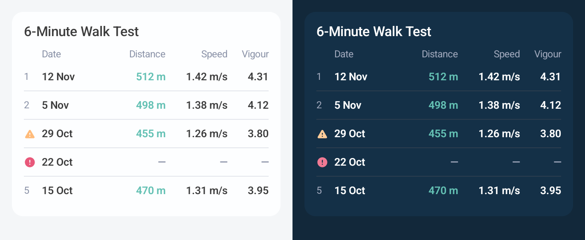

```kotlin
// WalkTestResultsCard.kt
package com.example.tracker

import androidx.compose.foundation.clickable
import androidx.compose.foundation.layout.Box
import androidx.compose.foundation.layout.Row
import androidx.compose.foundation.layout.RowScope
import androidx.compose.foundation.layout.fillMaxWidth
import androidx.compose.foundation.layout.padding
import androidx.compose.foundation.layout.size
import androidx.compose.foundation.layout.width
import androidx.compose.material.icons.Icons
import androidx.compose.material.icons.rounded.Error
import androidx.compose.material.icons.rounded.Warning
import androidx.compose.material3.AlertDialog
import androidx.compose.material3.CircularProgressIndicator
import androidx.compose.material3.HorizontalDivider
import androidx.compose.material3.Icon
import androidx.compose.material3.Text
import androidx.compose.material3.TextButton
import androidx.compose.runtime.Composable
import androidx.compose.runtime.LaunchedEffect
import androidx.compose.runtime.getValue
import androidx.compose.runtime.mutableStateOf
import androidx.compose.runtime.remember
import androidx.compose.runtime.setValue
import androidx.compose.ui.Alignment
import androidx.compose.ui.Modifier
import androidx.compose.ui.graphics.Color
import androidx.compose.ui.text.font.FontWeight
import androidx.compose.ui.text.style.TextAlign
import androidx.compose.ui.unit.dp
import androidx.lifecycle.compose.collectAsStateWithLifecycle
import java.time.LocalDate
import java.time.format.DateTimeFormatter
import kotlin.math.roundToInt

/**
 * The latest 6-minute walk test results, as in the tracKer app's Stats tab. A flagged
 * test shows a mark instead of its number; tapping it says what's wrong. Reloads
 * after each upload.
 */
@Composable
fun WalkTestResultsCard(model: TrackerModel, modifier: Modifier = Modifier, limit: Int = 5) {
    val status by model.status.collectAsStateWithLifecycle()
    var results by remember { mutableStateOf<List<WalkTestResult>?>(null) }
    var failed by remember { mutableStateOf(false) }

    LaunchedEffect(status?.sync?.lastSyncedAt) {
        runCatching { KinetikosApi.walkTests() }
            .onSuccess { results = it; failed = false }
            .onFailure { failed = results == null } // Keep showing what was loaded before.
    }
    WalkTestResultsCard(results, modifier, failed = failed, limit = limit)
}

/**
 * The results card for [results] already loaded: null while they load, or, with
 * [failed], when they couldn't be. Tests without data are left out.
 */
@Composable
fun WalkTestResultsCard(
    results: List<WalkTestResult>?,
    modifier: Modifier = Modifier,
    failed: Boolean = false,
    limit: Int = 5,
) {
    val theme = TrackerTheme.current
    var explaining by remember { mutableStateOf<WalkTestResult.Flag?>(null) }
    val tests = results?.filter { it.flag != WalkTestResult.Flag.NO_DATA }

    TrackerCard(modifier) {
        Text("6-Minute Walk Test", style = theme.titleFont, color = theme.text)
        when {
            tests != null && tests.isEmpty() -> Message("No results yet. A completed test shows here a few minutes after it's uploaded.")
            tests != null -> {
                Header()
                tests.take(limit).forEachIndexed { index, test ->
                    if (index > 0) HorizontalDivider(color = theme.separator.copy(alpha = 0.5f))
                    ResultRow(number = index + 1, test = test, onExplain = { explaining = it })
                }
            }
            failed -> Message("Couldn't load your results.")
            else -> Box(Modifier.fillMaxWidth().padding(top = 16.dp), contentAlignment = Alignment.Center) {
                CircularProgressIndicator(Modifier.size(24.dp), color = theme.primary, strokeWidth = 2.dp)
            }
        }
    }

    explaining?.let { flag ->
        val invalid = flag == WalkTestResult.Flag.INVALID
        AlertDialog(
            onDismissRequest = { explaining = null },
            icon = {
                Icon(
                    if (invalid) Icons.Rounded.Error else Icons.Rounded.Warning,
                    contentDescription = null,
                    tint = if (invalid) theme.error else theme.warning,
                )
            },
            title = { Text(if (invalid) "Invalid test" else "Anomalies found") },
            text = {
                Text(
                    if (invalid) {
                        "This test was considered invalid. Please repeat the test."
                    } else {
                        "Some anomalies were found while processing this test. " +
                            "We recommend repeating the test to make sure the results are valid."
                    },
                )
            },
            confirmButton = { TextButton(onClick = { explaining = null }) { Text("OK") } },
        )
    }
}

// ---------- Pieces ----------

private const val DATE_WEIGHT = 2f
private const val DISTANCE_WEIGHT = 1.6f
private const val SPEED_WEIGHT = 1.8f
private const val VIGOUR_WEIGHT = 1.2f
private val MarkerWidth = 24.dp

@Composable
private fun Message(text: String) {
    val theme = TrackerTheme.current
    Text(text, style = theme.bodyFont, color = theme.secondaryText, modifier = Modifier.padding(top = 12.dp))
}

@Composable
private fun Header() {
    Row(Modifier.fillMaxWidth().padding(top = 12.dp, bottom = 4.dp)) {
        Box(Modifier.width(MarkerWidth))
        HeaderCell("Date", DATE_WEIGHT, TextAlign.Start)
        HeaderCell("Distance", DISTANCE_WEIGHT)
        HeaderCell("Speed", SPEED_WEIGHT)
        HeaderCell("Vigour", VIGOUR_WEIGHT)
    }
}

@Composable
private fun RowScope.HeaderCell(text: String, weight: Float, align: TextAlign = TextAlign.End) {
    val theme = TrackerTheme.current
    Text(text, style = theme.captionFont, color = theme.secondaryText, textAlign = align, modifier = Modifier.weight(weight))
}

/** One test. An invalid one shows dashes: its figures are the ones nobody should read. */
@Composable
private fun ResultRow(number: Int, test: WalkTestResult, onExplain: (WalkTestResult.Flag) -> Unit) {
    val theme = TrackerTheme.current
    val flag = test.flag
    val invalid = flag == WalkTestResult.Flag.INVALID
    Row(
        verticalAlignment = Alignment.CenterVertically,
        modifier = Modifier
            .fillMaxWidth()
            .then(if (flag != null) Modifier.clickable { onExplain(flag) } else Modifier)
            .padding(vertical = 10.dp),
    ) {
        Box(Modifier.width(MarkerWidth)) {
            when (flag) {
                WalkTestResult.Flag.INVALID ->
                    Icon(Icons.Rounded.Error, contentDescription = "Invalid test", tint = theme.error, modifier = Modifier.size(16.dp))
                WalkTestResult.Flag.DOUBTFUL ->
                    Icon(Icons.Rounded.Warning, contentDescription = "Anomalies found", tint = theme.warning, modifier = Modifier.size(16.dp))
                else -> Text("$number", style = theme.captionFont, color = theme.secondaryText)
            }
        }
        ValueCell(test.day?.let(::formatDay) ?: test.dateRef ?: "—", DATE_WEIGHT, TextAlign.Start)
        if (invalid) {
            ValueCell("—", DISTANCE_WEIGHT, color = theme.secondaryText)
            ValueCell("—", SPEED_WEIGHT, color = theme.secondaryText)
            ValueCell("—", VIGOUR_WEIGHT, color = theme.secondaryText)
        } else {
            ValueCell(test.stepDistance?.let { "${it.roundToInt()} m" } ?: "—", DISTANCE_WEIGHT, color = theme.primary)
            ValueCell(test.velocity?.let { "%.2f m/s".format(it) } ?: "—", SPEED_WEIGHT)
            ValueCell(test.mets?.let { "%.2f".format(it) } ?: "—", VIGOUR_WEIGHT)
        }
    }
}

@Composable
private fun RowScope.ValueCell(
    text: String,
    weight: Float,
    align: TextAlign = TextAlign.End,
    color: Color = TrackerTheme.current.text,
) {
    Text(
        text,
        style = TrackerTheme.current.bodyFont,
        fontWeight = FontWeight.SemiBold,
        color = color,
        textAlign = align,
        maxLines = 1,
        modifier = Modifier.weight(weight),
    )
}

/** "3 Aug", or "22 Jun 2025" for a test from an earlier year. */
private fun formatDay(day: LocalDate): String =
    day.format(DateTimeFormatter.ofPattern(if (day.year == LocalDate.now().year) "d MMM" else "d MMM yyyy"))
```

## 11. About You

The four values, read-only once complete and with an Edit button. `onCompleteChange` tells the rest of your app, e.g. to unlock the walk test. The gender picker offers Male and Female, as the tracKer app does; add `intersex` and `prefer_not_to_say` to `SelectableGenders` if you want them.

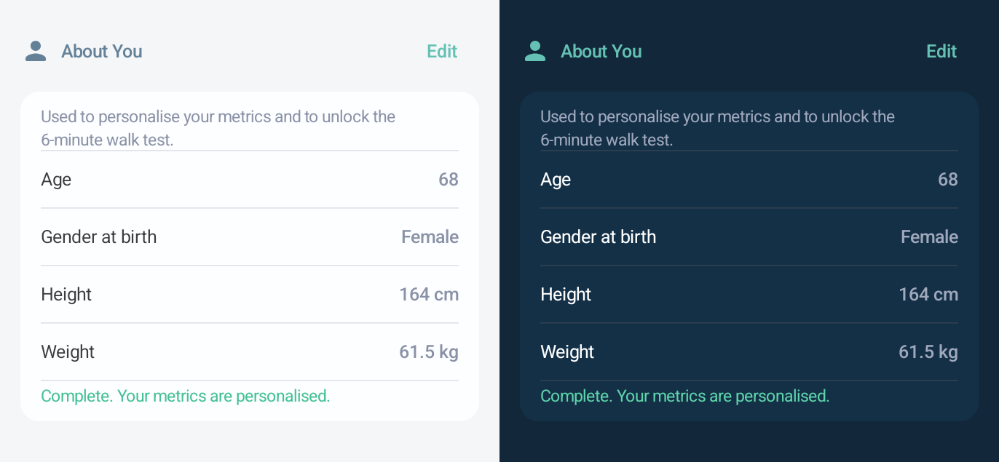

```kotlin
// AboutYouSection.kt
package com.example.tracker

import androidx.compose.foundation.clickable
import androidx.compose.foundation.layout.Arrangement
import androidx.compose.foundation.layout.Box
import androidx.compose.foundation.layout.Column
import androidx.compose.foundation.layout.PaddingValues
import androidx.compose.foundation.layout.Row
import androidx.compose.foundation.layout.fillMaxWidth
import androidx.compose.foundation.layout.heightIn
import androidx.compose.foundation.layout.padding
import androidx.compose.foundation.layout.size
import androidx.compose.foundation.text.KeyboardOptions
import androidx.compose.material.icons.Icons
import androidx.compose.material.icons.automirrored.rounded.KeyboardArrowRight
import androidx.compose.material.icons.rounded.Person
import androidx.compose.material3.AlertDialog
import androidx.compose.material3.CircularProgressIndicator
import androidx.compose.material3.DatePicker
import androidx.compose.material3.DatePickerDialog
import androidx.compose.material3.ExperimentalMaterial3Api
import androidx.compose.material3.HorizontalDivider
import androidx.compose.material3.Icon
import androidx.compose.material3.OutlinedTextField
import androidx.compose.material3.RadioButton
import androidx.compose.material3.SelectableDates
import androidx.compose.material3.Text
import androidx.compose.material3.TextButton
import androidx.compose.material3.rememberDatePickerState
import androidx.compose.runtime.Composable
import androidx.compose.runtime.LaunchedEffect
import androidx.compose.runtime.getValue
import androidx.compose.runtime.mutableStateOf
import androidx.compose.runtime.remember
import androidx.compose.runtime.rememberCoroutineScope
import androidx.compose.runtime.setValue
import androidx.compose.ui.Alignment
import androidx.compose.ui.Modifier
import androidx.compose.ui.text.input.KeyboardType
import androidx.compose.ui.unit.dp
import java.time.Instant
import java.time.LocalDate
import java.time.Period
import java.time.ZoneOffset
import java.time.format.DateTimeFormatter
import java.time.format.FormatStyle
import kotlinx.coroutines.launch

/**
 * About You: date of birth, gender at birth, height and weight. Read-only once
 * complete, with an Edit button. [onCompleteChange] tells the rest of your app,
 * e.g. to unlock the walk test.
 */
@Composable
fun AboutYouSection(onCompleteChange: (Boolean) -> Unit, modifier: Modifier = Modifier) {
    var saved by remember { mutableStateOf<Demographics?>(null) }
    LaunchedEffect(Unit) {
        runCatching { KinetikosApi.demographics() }
            .onSuccess {
                saved = it
                onCompleteChange(it.isComplete)
            }
            .onFailure { saved = Demographics() } // Nothing to go by: start from empty fields.
    }
    AboutYouSection(
        demographics = saved,
        onSave = { entered ->
            runCatching { KinetikosApi.saveDemographics(entered) }
                .onSuccess {
                    saved = it
                    onCompleteChange(it.isComplete)
                }
                .isSuccess
        },
        modifier = modifier,
    )
}

/**
 * About You for [demographics] already loaded, null while they load. Opens for
 * editing while they aren't complete. [onSave] gets all four values and returns
 * whether they were saved.
 */
@Composable
fun AboutYouSection(
    demographics: Demographics?,
    onSave: suspend (Demographics) -> Boolean,
    modifier: Modifier = Modifier,
) {
    val theme = TrackerTheme.current
    val scope = rememberCoroutineScope()
    var editing by remember(demographics) { mutableStateOf(demographics?.isComplete == false) }
    var birthDate by remember(demographics) { mutableStateOf(demographics?.dateOfBirth?.let(::kinetikosDay)) }
    var gender by remember(demographics) { mutableStateOf(demographics?.genderAtBirth) }
    var height by remember(demographics) { mutableStateOf(demographics?.heightCm?.plain().orEmpty()) }
    var weight by remember(demographics) { mutableStateOf(demographics?.weightKg?.plain().orEmpty()) }
    var saving by remember { mutableStateOf(false) }
    var problem by remember { mutableStateOf<String?>(null) }
    var pickingDate by remember { mutableStateOf(false) }
    var pickingGender by remember { mutableStateOf(false) }

    val heightCm = number(height, 50.0..260.0)
    val weightKg = number(weight, 10.0..400.0)
    // What was entered, if all four are valid.
    val entered = if (birthDate != null && gender != null && heightCm != null && weightKg != null) {
        Demographics(birthDate?.toString(), gender, heightCm, weightKg)
    } else {
        null
    }
    val isComplete = demographics?.isComplete == true

    Column(modifier.fillMaxWidth(), verticalArrangement = Arrangement.spacedBy(8.dp)) {
        Row(verticalAlignment = Alignment.CenterVertically, horizontalArrangement = Arrangement.spacedBy(8.dp)) {
            Icon(Icons.Rounded.Person, contentDescription = null, tint = theme.sectionTitle)
            Text("About You", style = theme.emphasisFont, color = theme.sectionTitle, modifier = Modifier.weight(1f))
            if (demographics != null && !editing) {
                TextButton(onClick = { editing = true }) { Text("Edit", style = theme.emphasisFont, color = theme.primary) }
            }
        }
        TrackerCard(padding = PaddingValues(horizontal = 16.dp, vertical = 12.dp)) {
            Text(
                "Used to personalise your metrics and to unlock the 6-minute walk test.",
                style = theme.captionFont,
                color = theme.secondaryText,
            )
            RowDivider()

            if (demographics == null) {
                Box(Modifier.fillMaxWidth().padding(vertical = 12.dp), contentAlignment = Alignment.Center) {
                    CircularProgressIndicator(Modifier.size(24.dp), color = theme.primary, strokeWidth = 2.dp)
                }
            } else if (editing) {
                PickerRow(
                    "Date of birth",
                    birthDate?.format(DateTimeFormatter.ofLocalizedDate(FormatStyle.MEDIUM)) ?: "Select",
                    onClick = { pickingDate = true },
                )
                RowDivider()
                PickerRow("Gender at birth", gender?.let(::genderLabel) ?: "Select", onClick = { pickingGender = true })
                RowDivider()
                NumberField("Height", "cm", height, { height = it }, valid = height.isBlank() || heightCm != null, hint = "Between 50 and 260 cm")
                NumberField("Weight", "kg", weight, { weight = it }, valid = weight.isBlank() || weightKg != null, hint = "Between 10 and 400 kg")
                problem?.let { Text(it, style = theme.captionFont, color = theme.error) }
                TrackerButton(
                    text = if (saving) "Saving…" else "Save",
                    enabled = entered != null && !saving,
                    onClick = {
                        val values = entered ?: return@TrackerButton
                        scope.launch {
                            saving = true
                            val ok = onSave(values)
                            saving = false
                            problem = if (ok) null else "Couldn't save. Please try again."
                            if (ok) editing = false
                        }
                    },
                    modifier = Modifier.padding(vertical = 8.dp),
                )
            } else {
                ValueRow("Age", birthDate?.let { "${Period.between(it, LocalDate.now()).years}" } ?: "—")
                RowDivider()
                ValueRow("Gender at birth", gender?.let(::genderLabel) ?: "—")
                RowDivider()
                ValueRow("Height", "$height cm")
                RowDivider()
                ValueRow("Weight", "$weight kg")
            }

            if (demographics != null) {
                RowDivider()
                Text(
                    if (isComplete) "Complete. Your metrics are personalised." else "Fill in all four fields to complete your profile.",
                    style = theme.captionFont,
                    color = if (isComplete) theme.success else theme.secondaryText,
                    modifier = Modifier.padding(top = 4.dp),
                )
            }
        }
    }

    if (pickingDate) {
        BirthDateDialog(
            initial = birthDate,
            onPick = {
                birthDate = it
                pickingDate = false
            },
            onDismiss = { pickingDate = false },
        )
    }
    if (pickingGender) {
        AlertDialog(
            onDismissRequest = { pickingGender = false },
            title = { Text("Gender at birth") },
            text = {
                Column {
                    SelectableGenders.forEach { option ->
                        Row(
                            verticalAlignment = Alignment.CenterVertically,
                            modifier = Modifier
                                .fillMaxWidth()
                                .clickable {
                                    gender = option
                                    pickingGender = false
                                },
                        ) {
                            RadioButton(selected = option == gender, onClick = {
                                gender = option
                                pickingGender = false
                            })
                            Text(genderLabel(option), style = theme.bodyFont)
                        }
                    }
                }
            },
            confirmButton = {},
            dismissButton = { TextButton(onClick = { pickingGender = false }) { Text("Cancel") } },
        )
    }
}

// ---------- Pieces ----------

/**
 * What the gender picker offers, as the tracKer app does. Kinetikos also accepts
 * "intersex" and "prefer_not_to_say": add them here if your study offers them.
 */
private val SelectableGenders = listOf("male", "female")

private fun genderLabel(value: String): String = when (value) {
    "male" -> "Male"
    "female" -> "Female"
    "intersex" -> "Intersex"
    "prefer_not_to_say" -> "Prefer not to say"
    else -> value
}

/** Accepts a comma as the decimal separator. */
private fun number(text: String, range: ClosedFloatingPointRange<Double>): Double? =
    text.trim().replace(',', '.').toDoubleOrNull()?.takeIf { it in range }

/** 172.0 as "172", 68.5 as "68.5". */
private fun Double.plain(): String = toBigDecimal().stripTrailingZeros().toPlainString()

@Composable
private fun RowDivider() {
    HorizontalDivider(color = TrackerTheme.current.separator.copy(alpha = 0.5f))
}

@Composable
private fun ValueRow(label: String, value: String) {
    val theme = TrackerTheme.current
    Row(Modifier.fillMaxWidth().heightIn(min = 44.dp), verticalAlignment = Alignment.CenterVertically) {
        Text(label, style = theme.bodyFont, color = theme.text, modifier = Modifier.weight(1f))
        Text(value, style = theme.emphasisFont, color = theme.secondaryText)
    }
}

@Composable
private fun PickerRow(label: String, value: String, onClick: () -> Unit) {
    val theme = TrackerTheme.current
    Row(
        verticalAlignment = Alignment.CenterVertically,
        modifier = Modifier.fillMaxWidth().heightIn(min = 48.dp).clickable(onClick = onClick),
    ) {
        Text(label, style = theme.bodyFont, color = theme.text, modifier = Modifier.weight(1f))
        Text(value, style = theme.emphasisFont, color = theme.secondaryText)
        Icon(Icons.AutoMirrored.Rounded.KeyboardArrowRight, contentDescription = null, tint = theme.secondaryText)
    }
}

@Composable
private fun NumberField(
    label: String,
    unit: String,
    text: String,
    onChange: (String) -> Unit,
    valid: Boolean,
    hint: String,
) {
    OutlinedTextField(
        value = text,
        onValueChange = onChange,
        label = { Text(label) },
        suffix = { Text(unit) },
        singleLine = true,
        isError = !valid,
        supportingText = if (valid) null else ({ Text(hint) }),
        keyboardOptions = KeyboardOptions(keyboardType = KeyboardType.Decimal),
        modifier = Modifier.fillMaxWidth(),
    )
}

/** A date picker from 120 years ago to today. It speaks UTC midnight, so dates go through epoch days. */
@OptIn(ExperimentalMaterial3Api::class)
@Composable
private fun BirthDateDialog(initial: LocalDate?, onPick: (LocalDate) -> Unit, onDismiss: () -> Unit) {
    val today = remember { LocalDate.now() }
    val oldest = remember { today.minusYears(120) }
    val state = rememberDatePickerState(
        initialSelectedDateMillis = initial?.takeIf { it in oldest..today }?.toUtcMillis(),
        initialDisplayedMonthMillis = (initial?.takeIf { it in oldest..today } ?: today.minusYears(60)).toUtcMillis(),
        yearRange = oldest.year..today.year,
        selectableDates = object : SelectableDates {
            override fun isSelectableDate(utcTimeMillis: Long) = utcTimeMillis.toUtcDate() in oldest..today
            override fun isSelectableYear(year: Int) = year in oldest.year..today.year
        },
    )
    DatePickerDialog(
        onDismissRequest = onDismiss,
        confirmButton = {
            TextButton(
                enabled = state.selectedDateMillis != null,
                onClick = { state.selectedDateMillis?.let { onPick(it.toUtcDate()) } },
            ) { Text("OK") }
        },
        dismissButton = { TextButton(onClick = onDismiss) { Text("Cancel") } },
    ) {
        DatePicker(state = state)
    }
}

private fun LocalDate.toUtcMillis(): Long = atStartOfDay(ZoneOffset.UTC).toInstant().toEpochMilli()

private fun Long.toUtcDate(): LocalDate = Instant.ofEpochMilli(this).atZone(ZoneOffset.UTC).toLocalDate()
```

## 12. Gait Vitals

Yesterday's walking against the person's usual range, as on the tracKer app's Stats tab: a band for the usual range, a strip above and below it for outliers, and one point per metric, coloured typical, mild or outlier. Tapping a point gives its figures. With no walking yesterday, the graph is empty and says so. The ⓘ explains the card; `TrackerHelpButton` and `TrackerHelpSheet` are used by [Walking pattern](#13-walking-pattern) too.

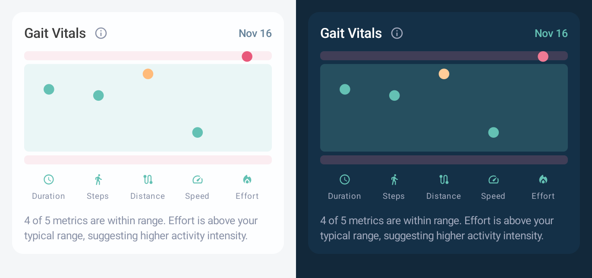

```kotlin
// GaitVitalsCard.kt
package com.example.tracker

import android.text.format.DateFormat
import androidx.compose.animation.core.Animatable
import androidx.compose.animation.core.FastOutSlowInEasing
import androidx.compose.animation.core.LinearEasing
import androidx.compose.animation.core.tween
import androidx.compose.foundation.Canvas
import androidx.compose.foundation.background
import androidx.compose.foundation.gestures.detectTapGestures
import androidx.compose.foundation.layout.Arrangement
import androidx.compose.foundation.layout.Column
import androidx.compose.foundation.layout.Row
import androidx.compose.foundation.layout.Spacer
import androidx.compose.foundation.layout.fillMaxWidth
import androidx.compose.foundation.layout.height
import androidx.compose.foundation.layout.padding
import androidx.compose.foundation.layout.size
import androidx.compose.foundation.rememberScrollState
import androidx.compose.foundation.shape.RoundedCornerShape
import androidx.compose.foundation.verticalScroll
import androidx.compose.material.icons.Icons
import androidx.compose.material.icons.automirrored.rounded.DirectionsWalk
import androidx.compose.material.icons.outlined.Info
import androidx.compose.material.icons.rounded.LocalFireDepartment
import androidx.compose.material.icons.rounded.Route
import androidx.compose.material.icons.rounded.Schedule
import androidx.compose.material.icons.rounded.Speed
import androidx.compose.material3.ExperimentalMaterial3Api
import androidx.compose.material3.Icon
import androidx.compose.material3.IconButton
import androidx.compose.material3.ModalBottomSheet
import androidx.compose.material3.Text
import androidx.compose.material3.TextButton
import androidx.compose.material3.rememberModalBottomSheetState
import androidx.compose.runtime.Composable
import androidx.compose.runtime.LaunchedEffect
import androidx.compose.runtime.getValue
import androidx.compose.runtime.mutableStateOf
import androidx.compose.runtime.remember
import androidx.compose.runtime.rememberCoroutineScope
import androidx.compose.runtime.rememberUpdatedState
import androidx.compose.runtime.saveable.rememberSaveable
import androidx.compose.runtime.setValue
import androidx.compose.ui.Alignment
import androidx.compose.ui.Modifier
import androidx.compose.ui.draw.alpha
import androidx.compose.ui.draw.clip
import androidx.compose.ui.geometry.CornerRadius
import androidx.compose.ui.geometry.Offset
import androidx.compose.ui.geometry.Size
import androidx.compose.ui.graphics.Color
import androidx.compose.ui.graphics.vector.ImageVector
import androidx.compose.ui.input.pointer.pointerInput
import androidx.compose.ui.platform.LocalInspectionMode
import androidx.compose.ui.semantics.contentDescription
import androidx.compose.ui.semantics.semantics
import androidx.compose.ui.text.style.TextOverflow
import androidx.compose.ui.unit.dp
import androidx.compose.ui.unit.sp
import java.time.format.DateTimeFormatter
import java.util.Locale
import kotlinx.coroutines.CancellationException
import kotlinx.coroutines.launch

/**
 * Yesterday's walking against the person's usual range: a band for the usual range,
 * a strip above and below it for outliers, and one point per metric, coloured
 * typical, mild or outlier. Tapping a point gives its figures. A null [report]
 * (still loading) or a day without walking shows the empty graph.
 */
@Composable
fun GaitVitalsCard(report: GaitVitalsReport?, modifier: Modifier = Modifier) {
    val theme = TrackerTheme.current
    val vitals = report?.gaitVitals?.vitals.orEmpty()
    var selected by remember(report?.date) { mutableStateOf<GaitMetric?>(null) }
    var showingHelp by rememberSaveable { mutableStateOf(false) }

    TrackerCard(modifier) {
        Column(verticalArrangement = Arrangement.spacedBy(12.dp)) {
            Row(verticalAlignment = Alignment.CenterVertically, horizontalArrangement = Arrangement.spacedBy(8.dp)) {
                Text("Gait Vitals", style = theme.titleFont, color = theme.text)
                TrackerHelpButton(label = "About Gait Vitals", onClick = { showingHelp = true })
                Spacer(Modifier.weight(1f))
                report?.day?.let { day ->
                    Text(day.format(localized("dMMM")), style = theme.emphasisFont, color = theme.sectionTitle)
                }
            }

            VitalsGraph(
                vitals = vitals,
                selected = selected,
                onSelect = { metric -> selected = if (selected == metric) null else metric },
            )

            Row(Modifier.fillMaxWidth()) {
                val metrics = if (vitals.isEmpty()) GaitMetric.entries else vitals.map { it.metric }
                metrics.forEach { metric ->
                    Column(
                        horizontalAlignment = Alignment.CenterHorizontally,
                        verticalArrangement = Arrangement.spacedBy(2.dp),
                        modifier = Modifier
                            .weight(1f)
                            .alpha(if (selected == null || selected == metric) 1f else 0.4f),
                    ) {
                        Icon(metric.icon, contentDescription = null, tint = theme.primary, modifier = Modifier.size(16.dp))
                        Text(
                            metric.title,
                            fontSize = 11.sp,
                            color = theme.secondaryText,
                            maxLines = 1,
                            overflow = TextOverflow.Ellipsis,
                        )
                    }
                }
            }

            Text(caption(report, selected), style = theme.bodyFont, color = theme.secondaryText)
        }
    }

    if (showingHelp) {
        TrackerHelpSheet(title = "About Gait Vitals", text = GAIT_VITALS_HELP, onDismiss = { showingHelp = false })
    }
}

/** [GaitVitalsCard] for yesterday, loaded from Kinetikos. */
@Composable
fun GaitVitalsCard(modifier: Modifier = Modifier) {
    var report by remember { mutableStateOf<GaitVitalsReport?>(null) }
    LaunchedEffect(Unit) {
        report = try {
            KinetikosApi.gaitVitals()
        } catch (e: CancellationException) {
            throw e
        } catch (e: Exception) {
            null // Signed out or offline: the empty graph.
        }
    }
    GaitVitalsCard(report, modifier)
}

/** The icon beside a metric's name. */
val GaitMetric.icon: ImageVector
    get() = when (this) {
        GaitMetric.DURATION -> Icons.Rounded.Schedule
        GaitMetric.STEPS -> Icons.AutoMirrored.Rounded.DirectionsWalk
        GaitMetric.DISTANCE -> Icons.Rounded.Route
        GaitMetric.SPEED -> Icons.Rounded.Speed
        GaitMetric.VIGOUR -> Icons.Rounded.LocalFireDepartment
    }

/** The ⓘ beside a card's title. [label] is what a screen reader says. */
@Composable
fun TrackerHelpButton(label: String, onClick: () -> Unit, modifier: Modifier = Modifier) {
    IconButton(onClick = onClick, modifier = modifier.size(24.dp)) {
        Icon(
            Icons.Outlined.Info,
            contentDescription = label,
            tint = TrackerTheme.current.secondaryText,
            modifier = Modifier.size(18.dp),
        )
    }
}

/** What the ⓘ opens: [text] under [title], in a bottom sheet. */
@OptIn(ExperimentalMaterial3Api::class)
@Composable
fun TrackerHelpSheet(title: String, text: String, onDismiss: () -> Unit) {
    val theme = TrackerTheme.current
    val sheetState = rememberModalBottomSheetState()
    val scope = rememberCoroutineScope()

    ModalBottomSheet(onDismissRequest = onDismiss, sheetState = sheetState, containerColor = theme.screenBackground) {
        Column(
            verticalArrangement = Arrangement.spacedBy(12.dp),
            modifier = Modifier
                .fillMaxWidth()
                .verticalScroll(rememberScrollState())
                .padding(horizontal = 16.dp)
                .padding(bottom = 32.dp),
        ) {
            Row(verticalAlignment = Alignment.CenterVertically) {
                Text(title, style = theme.titleFont, color = theme.text, modifier = Modifier.weight(1f))
                TextButton(onClick = { scope.launch { sheetState.hide() }.invokeOnCompletion { onDismiss() } }) {
                    Text("Done", style = theme.buttonFont, color = theme.primary)
                }
            }
            Text(
                text,
                style = theme.bodyFont,
                color = theme.text,
                modifier = Modifier
                    .fillMaxWidth()
                    .clip(RoundedCornerShape(theme.controlRadius))
                    .background(theme.cardBackground)
                    .padding(16.dp),
            )
        }
    }
}

// ---------- The graph ----------

/** The outlier strips, the gap between them and the band, and a point. */
private val Strip = 12.dp
private val Gap = 5.dp
private val PointRadius = 7.dp

@Composable
private fun VitalsGraph(vitals: List<GaitVitals.Vital>, selected: GaitMetric?, onSelect: (GaitMetric) -> Unit) {
    val theme = TrackerTheme.current
    val band = theme.primary.copy(alpha = if (theme.isDark) 0.22f else 0.12f)
    val strip = theme.error.copy(alpha = if (theme.isDark) 0.20f else 0.10f)
    val currentOnSelect by rememberUpdatedState(onSelect)

    // The points rise from the middle into place, one after the other. A @Preview shows them in place.
    val stagger = 80
    val rise = 500
    val inPreview = LocalInspectionMode.current
    val appear = remember { Animatable(if (inPreview) 1f else 0f) }
    LaunchedEffect(Unit) {
        appear.animateTo(1f, tween(rise + stagger * (GaitMetric.entries.size - 1), easing = LinearEasing))
    }
    val total = rise + stagger * (GaitMetric.entries.size - 1)

    Canvas(
        Modifier
            .fillMaxWidth()
            .height(150.dp)
            .pointerInput(vitals) {
                detectTapGestures { offset ->
                    if (vitals.isEmpty()) return@detectTapGestures
                    // One tap target per column.
                    val column = (offset.x / size.width * vitals.size).toInt().coerceIn(0, vitals.size - 1)
                    currentOnSelect(vitals[column].metric)
                }
            }
            .semantics {
                contentDescription = if (vitals.isEmpty()) {
                    "Gait Vitals: no walking"
                } else {
                    vitals.joinToString { "${it.metric.title}: ${label(it.level)}" }
                }
            },
    ) {
        val stripHeight = Strip.toPx()
        val gap = Gap.toPx()
        val radius = PointRadius.toPx()
        val bandTop = stripHeight + gap
        val bandHeight = (size.height - 2 * (stripHeight + gap)).coerceAtLeast(0f)

        drawRoundRect(strip, size = Size(size.width, stripHeight), cornerRadius = CornerRadius(5.dp.toPx()))
        drawRoundRect(
            band,
            topLeft = Offset(0f, bandTop),
            size = Size(size.width, bandHeight),
            cornerRadius = CornerRadius(6.dp.toPx()),
        )
        drawRoundRect(
            strip,
            topLeft = Offset(0f, size.height - stripHeight),
            size = Size(size.width, stripHeight),
            cornerRadius = CornerRadius(5.dp.toPx()),
        )

        if (vitals.isEmpty()) return@Canvas
        val column = size.width / vitals.size
        vitals.forEachIndexed { index, vital ->
            val color = levelColor(vital.level, theme)
            val target = y(vital.z, size.height, stripHeight, gap, radius)
            val progress = ((appear.value * total - stagger * index) / rise).coerceIn(0f, 1f)
            val eased = FastOutSlowInEasing.transform(progress)
            val center = Offset(column * (index + 0.5f), size.height / 2 + (target - size.height / 2) * eased)
            if (vital.metric == selected) {
                drawCircle(color.copy(alpha = 0.3f), radius = radius * 1.8f, center = center)
            }
            drawCircle(color, radius = radius, center = center)
        }
    }
}

/**
 * Where a point sits: outliers (|z| ≥ 2) in the strips, the rest in the band, mild
 * ones (1 ≤ |z| < 2) at its edges. Always wholly on the graph.
 */
private fun y(z: Double, height: Float, strip: Float, gap: Float, radius: Float): Float {
    val zc = z.coerceIn(-3.0, 3.0).toFloat()
    val top = strip + gap + radius
    val bottom = height - strip - gap - radius
    val edge = (bottom - top) * 0.10f
    val y = when {
        zc >= 2 -> strip / 2 * (1 - (zc - 2))
        zc <= -2 -> height - strip / 2 * (1 - (-2 - zc))
        zc > 1 -> top + edge * (2 - zc)
        zc < -1 -> bottom - edge * (2 + zc)
        else -> bottom - edge - (bottom - top - 2 * edge) * (zc + 1) / 2
    }
    return y.coerceIn(radius, height - radius)
}

private fun levelColor(level: GaitVitals.Level, theme: TrackerTheme): Color = when (level) {
    GaitVitals.Level.TYPICAL -> theme.primary
    GaitVitals.Level.MILD -> theme.warning
    GaitVitals.Level.OUTLIER -> theme.error
}

private fun label(level: GaitVitals.Level): String = when (level) {
    GaitVitals.Level.TYPICAL -> "Typical"
    GaitVitals.Level.MILD -> "Mild deviation"
    GaitVitals.Level.OUTLIER -> "Outside typical range"
}

// ---------- The caption ----------

private fun caption(report: GaitVitalsReport?, selected: GaitMetric?): String {
    report?.gaitVitals?.vitals?.firstOrNull { it.metric == selected }?.let { vital ->
        val metric = vital.metric
        return "${metric.title}, ${label(vital.level).lowercase()}: ${metric.formatted(vital.value)} ${metric.unit}, " +
            "usually ${metric.formatted(vital.med)} ${metric.unit}."
    }
    val summary = report?.gaitVitals?.summary ?: return "No data recorded"
    if (summary.above.isEmpty() && summary.below.isEmpty()) {
        return "All metrics are within your typical range. Your movement pattern is consistent."
    }
    val parts = mutableListOf<String>()
    if (summary.within > 0) {
        parts += "${summary.within} of ${summary.total} metrics are within range."
    }
    if (summary.above.isNotEmpty()) {
        val verb = if (summary.above.size == 1) "is" else "are"
        parts += "${names(summary.above)} $verb above your typical range, suggesting higher activity intensity."
    }
    if (summary.below.isNotEmpty()) {
        val verb = if (summary.below.size == 1) "is" else "are"
        parts += "${names(summary.below)} $verb below your typical range, suggesting reduced activity."
    }
    return parts.joinToString(" ")
}

/** "Steps", "Steps and Speed", "Duration, Steps, and Speed". */
private fun names(metrics: List<GaitMetric>): String {
    val titles = metrics.map { it.title }
    return when (titles.size) {
        1 -> titles[0]
        2 -> "${titles[0]} and ${titles[1]}"
        else -> titles.dropLast(1).joinToString(", ") + ", and " + titles.last()
    }
}

/** A date format in the device's locale, from a skeleton such as "dMMM". */
private fun localized(skeleton: String): DateTimeFormatter {
    val locale = Locale.getDefault()
    return DateTimeFormatter.ofPattern(DateFormat.getBestDateTimePattern(locale, skeleton), locale)
}

private val GAIT_VITALS_HELP = """
    Gait Vitals compare yesterday's walking with your typical range across duration, steps, distance, speed, and effort. Your typical range comes from up to the previous 90 days of walking. If you didn't walk yesterday, the graph is empty.

    Green points are within your typical range. Orange points show mild deviations near the edge of your typical range. Red points are outside your typical range and may reflect an unusual walking day.
""".trimIndent()
```

## 13. Walking pattern

When the person usually walks, one metric at a time: a bar for each hour of the day and for each day of the week, the median of up to 90 days. The weekly chart's line is the average of its seven bars. Tapping a bar gives its value.

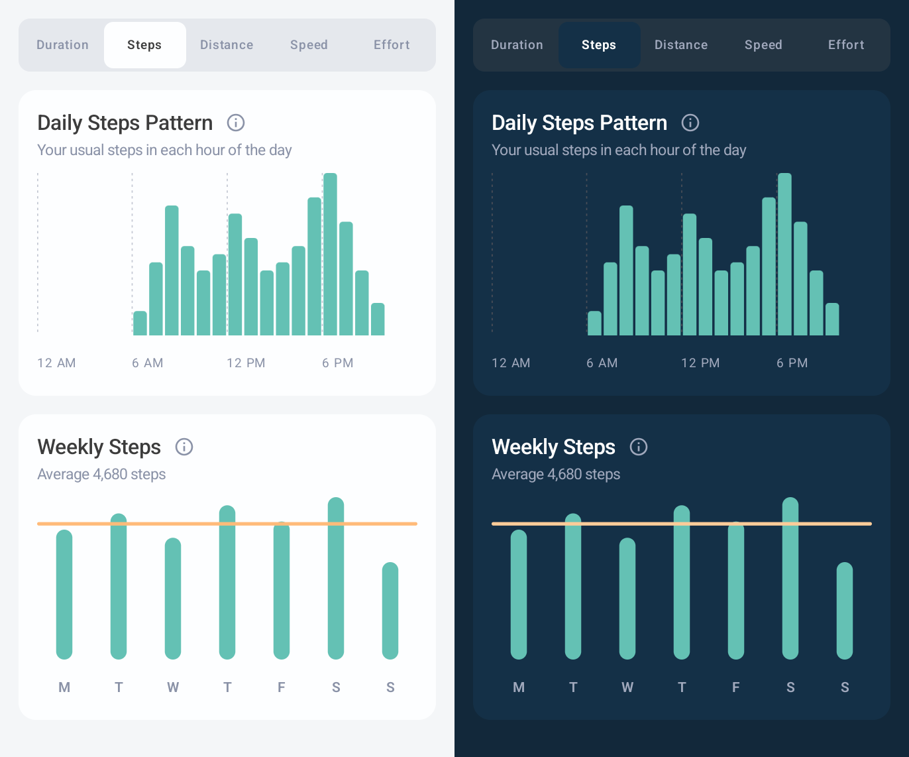

```kotlin
// WalkingPatternCards.kt
package com.example.tracker

import android.text.format.DateFormat
import androidx.compose.foundation.Canvas
import androidx.compose.foundation.background
import androidx.compose.foundation.gestures.detectTapGestures
import androidx.compose.foundation.layout.Arrangement
import androidx.compose.foundation.layout.Box
import androidx.compose.foundation.layout.Column
import androidx.compose.foundation.layout.Row
import androidx.compose.foundation.layout.fillMaxWidth
import androidx.compose.foundation.layout.height
import androidx.compose.foundation.layout.heightIn
import androidx.compose.foundation.layout.padding
import androidx.compose.foundation.selection.selectable
import androidx.compose.foundation.shape.RoundedCornerShape
import androidx.compose.material3.Text
import androidx.compose.runtime.Composable
import androidx.compose.runtime.LaunchedEffect
import androidx.compose.runtime.getValue
import androidx.compose.runtime.mutableStateOf
import androidx.compose.runtime.remember
import androidx.compose.runtime.rememberUpdatedState
import androidx.compose.runtime.saveable.rememberSaveable
import androidx.compose.runtime.setValue
import androidx.compose.ui.Alignment
import androidx.compose.ui.Modifier
import androidx.compose.ui.draw.clip
import androidx.compose.ui.geometry.CornerRadius
import androidx.compose.ui.geometry.Offset
import androidx.compose.ui.geometry.Rect
import androidx.compose.ui.geometry.RoundRect
import androidx.compose.ui.geometry.Size
import androidx.compose.ui.graphics.Color
import androidx.compose.ui.graphics.Path
import androidx.compose.ui.graphics.PathEffect
import androidx.compose.ui.graphics.StrokeCap
import androidx.compose.ui.graphics.drawscope.DrawScope
import androidx.compose.ui.input.pointer.pointerInput
import androidx.compose.ui.semantics.Role
import androidx.compose.ui.text.font.FontWeight
import androidx.compose.ui.text.style.TextAlign
import androidx.compose.ui.text.style.TextOverflow
import androidx.compose.ui.unit.dp
import androidx.compose.ui.unit.sp
import java.time.DayOfWeek
import java.time.LocalTime
import java.time.format.DateTimeFormatter
import java.time.format.TextStyle
import java.util.Locale
import kotlinx.coroutines.CancellationException

/**
 * When the person usually walks, one metric at a time: a bar for each hour of the day
 * and for each day of the week, the median of up to 90 days. The metric picker above
 * switches both cards.
 */
@Composable
fun WalkingPatternCards(report: GaitVitalsReport, modifier: Modifier = Modifier) {
    var metric by rememberSaveable { mutableStateOf(GaitMetric.STEPS) }

    Column(modifier, verticalArrangement = Arrangement.spacedBy(16.dp)) {
        MetricPicker(selected = metric, onSelect = { metric = it })
        DailyPatternCard(metric = metric, values = report.dailyPattern[metric])
        WeeklyPatternCard(metric = metric, values = report.weeklyPattern[metric])
    }
}

/** [WalkingPatternCards], loaded from Kinetikos. Shows nothing until there is a pattern. */
@Composable
fun WalkingPatternCards(modifier: Modifier = Modifier) {
    var report by remember { mutableStateOf<GaitVitalsReport?>(null) }
    LaunchedEffect(Unit) {
        report = try {
            KinetikosApi.gaitVitals()
        } catch (e: CancellationException) {
            throw e
        } catch (e: Exception) {
            null // Signed out or offline: nothing to show.
        }
    }
    report?.takeIf { it.hasPattern }?.let { WalkingPatternCards(it, modifier) }
}

/** The usual [metric] in each hour of the day: 24 [values], midnight first. Tap a bar for its value. */
@Composable
fun DailyPatternCard(metric: GaitMetric, values: List<Double?>, modifier: Modifier = Modifier) {
    val theme = TrackerTheme.current
    var hour by remember(metric, values) { mutableStateOf<Int?>(null) }
    var showingHelp by rememberSaveable { mutableStateOf(false) }

    val selectedHour = hour
    val selectedValue = selectedHour?.let { values.getOrNull(it) }
    val detail = if (selectedHour != null && selectedValue != null) {
        val time = localized("jmm")
        "${LocalTime.of(selectedHour, 0).format(time)} – ${LocalTime.of((selectedHour + 1) % 24, 0).format(time)}: " +
            "${metric.formatted(selectedValue)} ${metric.unit}"
    } else {
        "Your usual ${metric.title.lowercase()} in each hour of the day"
    }

    TrackerCard(modifier) {
        Column(verticalArrangement = Arrangement.spacedBy(12.dp)) {
            PatternHeader(title = "Daily ${metric.title} Pattern", metric = metric, detail = detail) { showingHelp = true }

            if (hasPattern(values)) {
                val max = values.maxOf { it ?: 0.0 }
                val bar = theme.primary
                val grid = theme.separator
                BarChart(
                    slots = values.size,
                    onTap = { slot -> hour = if (hour == slot || values[slot] == null) null else slot },
                ) {
                    val slot = size.width / values.size
                    val dash = PathEffect.dashPathEffect(floatArrayOf(2.dp.toPx(), 3.dp.toPx()))
                    for (mark in AXIS_HOURS) {
                        val x = (mark * slot).coerceAtLeast(0.5.dp.toPx())
                        drawLine(grid, Offset(x, 0f), Offset(x, size.height), strokeWidth = 1.dp.toPx(), pathEffect = dash)
                    }
                    values.forEachIndexed { index, value ->
                        if (value == null || value <= 0) return@forEachIndexed
                        val height = size.height * (value / max).toFloat().coerceIn(0.02f, 1f)
                        val gap = 1.dp.toPx()
                        drawTopRoundedBar(
                            color = if (selectedHour == null || selectedHour == index) bar else bar.copy(alpha = 0.4f),
                            left = index * slot + gap,
                            width = slot - 2 * gap,
                            height = height,
                            radius = 3.dp.toPx(),
                        )
                    }
                }
                Row(Modifier.fillMaxWidth()) {
                    val format = localized("j")
                    AXIS_HOURS.forEach { mark ->
                        Text(
                            LocalTime.of(mark, 0).format(format),
                            fontSize = 11.sp,
                            color = theme.secondaryText,
                            maxLines = 1,
                            modifier = Modifier.weight(1f),
                        )
                    }
                }
            } else {
                EmptyPattern()
            }
        }
    }

    if (showingHelp) {
        TrackerHelpSheet(title = "About ${metric.title}", text = metric.help, onDismiss = { showingHelp = false })
    }
}

/**
 * The usual [metric] on each day of the week: 7 [values], Monday first. The line is
 * the average of the seven bars. Tap a bar for its value.
 */
@Composable
fun WeeklyPatternCard(metric: GaitMetric, values: List<Double?>, modifier: Modifier = Modifier) {
    val theme = TrackerTheme.current
    var day by remember(metric, values) { mutableStateOf<Int?>(null) }
    var showingHelp by rememberSaveable { mutableStateOf(false) }
    val locale = Locale.getDefault()

    val known = values.filterNotNull()
    val average = if (known.isEmpty()) null else known.sum() / known.size
    val selectedDay = day
    val selectedValue = selectedDay?.let { values.getOrNull(it) }
    val detail = when {
        selectedDay != null && selectedValue != null ->
            "${weekday(selectedDay).getDisplayName(TextStyle.FULL, locale)}: ${metric.formatted(selectedValue)} ${metric.unit}"
        average != null -> "Average ${metric.formatted(average)} ${metric.unit}"
        else -> " "
    }

    TrackerCard(modifier) {
        Column(verticalArrangement = Arrangement.spacedBy(12.dp)) {
            PatternHeader(title = "Weekly ${metric.title}", metric = metric, detail = detail) { showingHelp = true }

            if (hasPattern(values)) {
                val max = values.maxOf { it ?: 0.0 }
                val bar = theme.primary
                val line = theme.warning
                BarChart(
                    slots = values.size,
                    onTap = { slot -> day = if (day == slot || values[slot] == null) null else slot },
                ) {
                    val slot = size.width / values.size
                    val width = 14.dp.toPx()
                    values.forEachIndexed { index, value ->
                        if (value == null || value <= 0) return@forEachIndexed
                        val height = size.height * (value / max).toFloat().coerceIn(0.06f, 1f)
                        drawRoundRect(
                            color = if (selectedDay == null || selectedDay == index) bar else bar.copy(alpha = 0.4f),
                            topLeft = Offset(slot * (index + 0.5f) - width / 2, size.height - height),
                            size = Size(width, height),
                            cornerRadius = CornerRadius(width / 2),
                        )
                    }
                    if (average != null) {
                        val stroke = 3.dp.toPx()
                        val y = (size.height * (1 - (average / max).toFloat())).coerceIn(stroke / 2, size.height - stroke / 2)
                        drawLine(line, Offset(stroke / 2, y), Offset(size.width - stroke / 2, y), strokeWidth = stroke, cap = StrokeCap.Round)
                    }
                }
                Row(Modifier.fillMaxWidth()) {
                    values.indices.forEach { index ->
                        Text(
                            weekday(index).getDisplayName(TextStyle.NARROW, locale),
                            fontSize = 12.sp,
                            fontWeight = FontWeight.SemiBold,
                            color = if (selectedDay == index) theme.text else theme.secondaryText,
                            textAlign = TextAlign.Center,
                            modifier = Modifier.weight(1f),
                        )
                    }
                }
            } else {
                EmptyPattern()
            }
        }
    }

    if (showingHelp) {
        TrackerHelpSheet(title = "About ${metric.title}", text = metric.help, onDismiss = { showingHelp = false })
    }
}

/** What the ⓘ on the pattern cards says. */
val GaitMetric.help: String
    get() {
        val about = when (this) {
            GaitMetric.DURATION ->
                "Duration is the time you spend walking, shown in minutes. It adds together the time taken by each step detected as you walk."
            GaitMetric.STEPS ->
                "Step count is the number of steps you take while walking, detected from the movement your phone's motion sensors record."
            GaitMetric.DISTANCE ->
                "Distance is how far you walk, shown in metres. The length of each step is estimated from your phone's motion sensors, and the lengths added together."
            GaitMetric.SPEED ->
                "Speed is how fast you walk, shown in metres per second, estimated from the length and timing of your steps."
            GaitMetric.VIGOUR ->
                "Effort measures how much work your body does while walking, combining how briskly you walk with how long you walk for. It's measured in MET-minutes: a MET compares the energy you use while moving with the energy you use at rest, so walking for 10 minutes at 3 METs adds up to 30 MET-minutes."
        }
        return about + "\n\n" + PATTERN_HELP
    }

// ---------- Pieces ----------

private val AXIS_HOURS = listOf(0, 6, 12, 18)

private const val PATTERN_HELP =
    "Each bar shows your median over up to your last 90 days: for each hour of the day on the daily chart, " +
        "and for each day of the week on the weekly chart. Only hours when you walked are counted, so a bar shows " +
        "what's usual when you do walk at that time, not how often you walk then. The median is the middle value, " +
        "so one unusual day has little effect.\n\nOn the weekly chart, the line shows the average of the seven bars."

/** The metric picker: one segment per metric. */
@Composable
private fun MetricPicker(selected: GaitMetric, onSelect: (GaitMetric) -> Unit) {
    val theme = TrackerTheme.current
    Row(
        Modifier
            .fillMaxWidth()
            .clip(RoundedCornerShape(10.dp))
            .background(theme.separator.copy(alpha = 0.3f))
            .padding(3.dp),
    ) {
        GaitMetric.entries.forEach { metric ->
            val isSelected = metric == selected
            Box(
                contentAlignment = Alignment.Center,
                modifier = Modifier
                    .weight(1f)
                    .clip(RoundedCornerShape(8.dp))
                    .background(if (isSelected) theme.cardBackground else Color.Transparent)
                    .selectable(selected = isSelected, role = Role.Tab, onClick = { onSelect(metric) })
                    .padding(vertical = 8.dp, horizontal = 2.dp),
            ) {
                Text(
                    metric.title,
                    fontSize = 11.sp,
                    fontWeight = if (isSelected) FontWeight.SemiBold else FontWeight.Medium,
                    color = if (isSelected) theme.text else theme.secondaryText,
                    maxLines = 1,
                    overflow = TextOverflow.Ellipsis,
                )
            }
        }
    }
}

@Composable
private fun PatternHeader(title: String, metric: GaitMetric, detail: String, onHelp: () -> Unit) {
    val theme = TrackerTheme.current
    Column(verticalArrangement = Arrangement.spacedBy(4.dp)) {
        Row(verticalAlignment = Alignment.CenterVertically, horizontalArrangement = Arrangement.spacedBy(8.dp)) {
            Text(title, style = theme.titleFont, color = theme.text)
            TrackerHelpButton(label = "About ${metric.title}", onClick = onHelp)
        }
        Text(detail, style = theme.captionFont, color = theme.secondaryText)
    }
}

@Composable
private fun EmptyPattern() {
    val theme = TrackerTheme.current
    Box(Modifier.fillMaxWidth().heightIn(min = 80.dp), contentAlignment = Alignment.Center) {
        Text("Not enough walking yet to show a pattern.", style = theme.bodyFont, color = theme.secondaryText)
    }
}

/** A chart of [slots] equal columns; a tap reports the column under it. */
@Composable
private fun BarChart(slots: Int, onTap: (Int) -> Unit, draw: DrawScope.() -> Unit) {
    val currentOnTap by rememberUpdatedState(onTap)
    Canvas(
        Modifier
            .fillMaxWidth()
            .height(140.dp)
            .pointerInput(slots) {
                detectTapGestures { offset ->
                    currentOnTap((offset.x / size.width * slots).toInt().coerceIn(0, slots - 1))
                }
            },
        onDraw = draw,
    )
}

/** A bar standing on the bottom of the chart, rounded at the top. */
private fun DrawScope.drawTopRoundedBar(color: Color, left: Float, width: Float, height: Float, radius: Float) {
    val corner = CornerRadius(radius.coerceAtMost(width / 2))
    val rect = Rect(left, size.height - height, left + width, size.height)
    val path = Path().apply {
        addRoundRect(RoundRect(rect, topLeft = corner, topRight = corner, bottomRight = CornerRadius.Zero, bottomLeft = CornerRadius.Zero))
    }
    drawPath(path, color)
}

private fun hasPattern(values: List<Double?>): Boolean = values.any { (it ?: 0.0) > 0 }

/** Slot 0 is Monday. */
private fun weekday(slot: Int): DayOfWeek = DayOfWeek.of(slot + 1)

/** A date or time format in the device's locale, from a skeleton such as "jmm". */
private fun localized(skeleton: String): DateTimeFormatter {
    val locale = Locale.getDefault()
    return DateTimeFormatter.ofPattern(DateFormat.getBestDateTimePattern(locale, skeleton), locale)
}
```

## 14. Walking this week

`RecordedWeekCard` ([Today's activity](#6-todays-activity-and-this-week)) with Kinetikos' figures: each bar is how much of the day was walking, once Kinetikos has analysed the recording. A day not analysed yet has no bar, and a partly analysed one is lighter, since it can still grow. The average counts only the days that won't change. Tapping a day shows its walking time beside its recorded time. Until Kinetikos answers, or when it has no analysis for the participant yet, the card shows recorded time instead. Analysis finishes with nothing on the phone to hear about it, so the card looks again whenever the app comes back to the foreground, and after each upload.

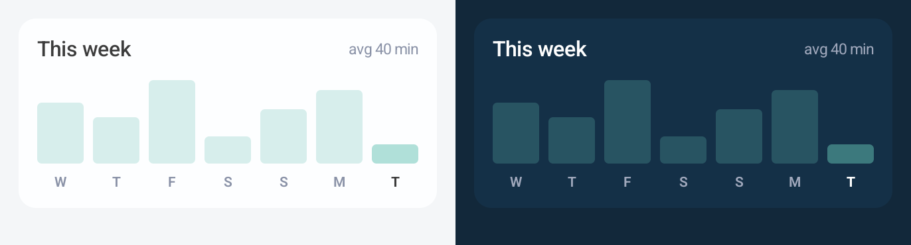

```kotlin
// WalkingWeekCard.kt
package com.example.tracker

import android.text.format.DateFormat
import androidx.compose.foundation.background
import androidx.compose.foundation.clickable
import androidx.compose.foundation.interaction.MutableInteractionSource
import androidx.compose.foundation.layout.Arrangement
import androidx.compose.foundation.layout.Box
import androidx.compose.foundation.layout.Column
import androidx.compose.foundation.layout.Row
import androidx.compose.foundation.layout.fillMaxHeight
import androidx.compose.foundation.layout.fillMaxWidth
import androidx.compose.foundation.layout.height
import androidx.compose.foundation.shape.RoundedCornerShape
import androidx.compose.material3.Text
import androidx.compose.runtime.Composable
import androidx.compose.runtime.getValue
import androidx.compose.runtime.mutableStateOf
import androidx.compose.runtime.remember
import androidx.compose.runtime.rememberCoroutineScope
import androidx.compose.runtime.setValue
import androidx.compose.ui.Alignment
import androidx.compose.ui.Modifier
import androidx.compose.ui.draw.clip
import androidx.compose.ui.semantics.clearAndSetSemantics
import androidx.compose.ui.semantics.contentDescription
import androidx.compose.ui.text.font.FontWeight
import androidx.compose.ui.text.style.TextAlign
import androidx.compose.ui.unit.dp
import androidx.compose.ui.unit.sp
import androidx.lifecycle.compose.LifecycleResumeEffect
import androidx.lifecycle.compose.collectAsStateWithLifecycle
import com.kinetikoshealth.tracKer.sdk.RecordedDay
import java.time.LocalDate
import java.time.format.DateTimeFormatter
import java.time.format.TextStyle
import java.util.Locale
import kotlin.math.roundToInt
import kotlinx.coroutines.CancellationException
import kotlinx.coroutines.launch

/**
 * The last seven days' walking time, today last. Each bar is how much of the day was
 * walking, once Kinetikos has analysed it: a day not analysed yet has no bar, a partly
 * analysed one is lighter, and the average counts only days that won't change. Tap a
 * day for its walking time beside its recorded time. While [week] is null, or has no
 * analysis, the bars are recorded time from [recordedDays].
 */
@Composable
fun WalkingWeekCard(week: WalkingWeek?, recordedDays: List<RecordedDay>, modifier: Modifier = Modifier) {
    val theme = TrackerTheme.current
    val locale = Locale.getDefault()
    val columns = columns(week, recordedDays)
    var selected by remember { mutableStateOf<LocalDate?>(null) }

    val tallest = (columns.mapNotNull { it.minutes }.maxOrNull() ?: 0.0).coerceAtLeast(1.0)
    val settled = columns.filter { it.countsInAverage }.mapNotNull { it.minutes }
    val average = if (settled.isEmpty()) 0 else settled.average().roundToInt()

    TrackerCard(modifier) {
        Column(verticalArrangement = Arrangement.spacedBy(16.dp)) {
            Row(Modifier.fillMaxWidth(), verticalAlignment = Alignment.CenterVertically) {
                Text("This week", style = theme.titleFont, color = theme.text, modifier = Modifier.weight(1f))
                Text("avg $average min", style = theme.captionFont, color = theme.secondaryText)
            }

            Row(
                Modifier
                    .fillMaxWidth()
                    .height(PlotHeight + 22.dp),
                horizontalArrangement = Arrangement.spacedBy(8.dp),
            ) {
                columns.forEach { column ->
                    val isSelected = selected == column.day
                    Column(
                        horizontalAlignment = Alignment.CenterHorizontally,
                        verticalArrangement = Arrangement.spacedBy(4.dp),
                        modifier = Modifier
                            .weight(1f)
                            .fillMaxHeight()
                            .clickable(interactionSource = remember { MutableInteractionSource() }, indication = null) {
                                selected = if (isSelected) null else column.day
                            }
                            .clearAndSetSemantics {
                                contentDescription =
                                    "${column.day.dayOfWeek.getDisplayName(TextStyle.FULL, locale)}, ${describe(column)}"
                            },
                    ) {
                        Box(Modifier.weight(1f).fillMaxWidth(), contentAlignment = Alignment.BottomCenter) {
                            val minutes = column.minutes
                            // Nothing walked draws no bar: a stub would read as a little walking.
                            if (minutes != null && minutes > 0) {
                                val base = if (column.isToday) theme.primary else theme.primary.copy(alpha = 0.25f)
                                // Lighter while partly analysed: it can still grow. Dimmed while another day is picked.
                                val alpha = (if (column.analysis == WalkingWeek.Analysis.PARTIAL) 0.5f else 1f) *
                                    (if (selected != null && !isSelected) 0.35f else 1f)
                                Box(
                                    Modifier
                                        .fillMaxWidth()
                                        .fillMaxHeight((minutes / tallest).toFloat().coerceIn(0.06f, 1f))
                                        .clip(RoundedCornerShape(4.dp))
                                        .background(base.copy(alpha = base.alpha * alpha)),
                                )
                            }
                        }
                        Text(
                            column.day.dayOfWeek.getDisplayName(TextStyle.NARROW, locale),
                            fontSize = 12.sp,
                            fontWeight = if (column.isToday || isSelected) FontWeight.Bold else FontWeight.SemiBold,
                            color = if (column.isToday || isSelected) theme.text else theme.secondaryText,
                            textAlign = TextAlign.Center,
                            modifier = Modifier.height(18.dp),
                        )
                    }
                }
            }

            columns.firstOrNull { it.day == selected }?.let { column ->
                val name = if (column.isToday) "Today" else column.day.format(localized("EEEEdMMM"))
                Text("$name: ${describe(column)}", style = theme.captionFont, color = theme.secondaryText)
            }
        }
    }
}

/**
 * [WalkingWeekCard] with Kinetikos' figures and [model]'s recorded time. Analysis
 * finishes with nothing on the phone to hear about it, so it looks again whenever the
 * app comes back to the foreground, and after each upload.
 */
@Composable
fun WalkingWeekCard(model: TrackerModel, modifier: Modifier = Modifier) {
    val recordedDays by model.recordedDays.collectAsStateWithLifecycle()
    val status by model.status.collectAsStateWithLifecycle()
    var week by remember { mutableStateOf<WalkingWeek?>(null) }
    val scope = rememberCoroutineScope()

    LifecycleResumeEffect(status?.sync?.lastSyncedAt) {
        val load = scope.launch {
            try {
                week = KinetikosApi.walkingWeek()
            } catch (e: CancellationException) {
                throw e
            } catch (e: Exception) {
                // Signed out or offline: keep what's shown.
            }
        }
        onPauseOrDispose { load.cancel() }
    }

    WalkingWeekCard(week, recordedDays, modifier)
}

// ---------- Columns ----------

private val PlotHeight = 72.dp

private data class WeekColumn(
    val day: LocalDate,
    /** The bar: walking time when [analysis] is set, recorded time otherwise. Null, no bar. */
    val minutes: Double?,
    val recorded: Double,
    val analysis: WalkingWeek.Analysis?,
    val isToday: Boolean,
) {
    /** A day still being analysed would drag the average down until it caught up. */
    val countsInAverage: Boolean get() = minutes != null && (analysis?.isSettled ?: true)
}

/** The phone's seven days, with Kinetikos' figures where it has them. */
private fun columns(week: WalkingWeek?, recordedDays: List<RecordedDay>): List<WeekColumn> {
    val today = LocalDate.now()
    val days = recordedDays.map { it.day }.ifEmpty { (6 downTo 0).map { today.minusDays(it.toLong()) } }
    val walking = week?.hasWalkingTime == true
    return days.map { day ->
        val phone = (recordedDays.firstOrNull { it.day == day }?.totalSeconds ?: 0) / 60.0
        val isToday = day == today
        val server = week?.days?.firstOrNull { kinetikosDay(it.date) == day }
            ?: return@map WeekColumn(day, phone, phone, null, isToday)
        // Uploads reach Kinetikos with a delay, so today takes the larger figure.
        val recorded = if (isToday) maxOf(server.totalMinutes, phone) else server.totalMinutes
        if (!walking) return@map WeekColumn(day, recorded, recorded, null, isToday)
        WeekColumn(day, server.processed?.walkingMinutes, recorded, server.processed?.status, isToday)
    }
}

private fun describe(column: WeekColumn): String {
    val recorded = column.recorded.roundToInt()
    val analysis = column.analysis
        ?: return column.minutes?.let { "${it.roundToInt()} min" } ?: "No data"
    val walking = column.minutes?.roundToInt()
    var text = when {
        analysis == WalkingWeek.Analysis.PENDING -> "Processing… $recorded min recorded"
        walking == null -> "No data · $recorded min recorded"
        analysis == WalkingWeek.Analysis.PARTIAL -> "$walking min walking so far · $recorded min recorded"
        else -> "$walking min walking · $recorded min recorded"
    }
    if (analysis == WalkingWeek.Analysis.FAILED) text += ". Couldn't analyse some recordings."
    return text
}

/** A date format in the device's locale, from a skeleton such as "EEEEdMMM". */
private fun localized(skeleton: String): DateTimeFormatter {
    val locale = Locale.getDefault()
    return DateTimeFormatter.ofPattern(DateFormat.getBestDateTimePattern(locale, skeleton), locale)
}
```

## 15. Putting it together

Four tabs, like the tracKer app: Today, Walk, Stats and Settings. The Consent screen opens by itself while Consent is missing. Call it from your activity, inside your theme:

```kotlin
setContent {
    ProvideTrackerTheme {
        TrackerTabs(onSignOut = { /* your own sign-out */ })
    }
}
```

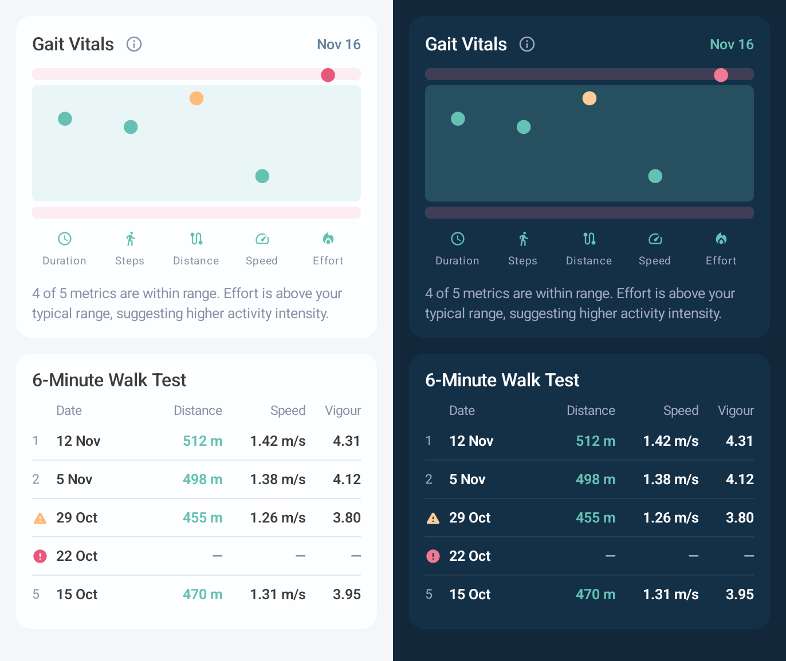

```kotlin
// TrackerTabs.kt
package com.example.tracker

import androidx.compose.foundation.background
import androidx.compose.foundation.layout.Arrangement
import androidx.compose.foundation.layout.Box
import androidx.compose.foundation.layout.Column
import androidx.compose.foundation.layout.ColumnScope
import androidx.compose.foundation.layout.Row
import androidx.compose.foundation.layout.fillMaxSize
import androidx.compose.foundation.layout.fillMaxWidth
import androidx.compose.foundation.layout.padding
import androidx.compose.foundation.rememberScrollState
import androidx.compose.foundation.verticalScroll
import androidx.compose.material.icons.Icons
import androidx.compose.material.icons.automirrored.rounded.DirectionsWalk
import androidx.compose.material.icons.rounded.BarChart
import androidx.compose.material.icons.rounded.Home
import androidx.compose.material.icons.rounded.Settings
import androidx.compose.material3.CircularProgressIndicator
import androidx.compose.material3.Icon
import androidx.compose.material3.NavigationBar
import androidx.compose.material3.NavigationBarItem
import androidx.compose.material3.NavigationBarItemDefaults
import androidx.compose.material3.Scaffold
import androidx.compose.material3.Text
import androidx.compose.runtime.Composable
import androidx.compose.runtime.LaunchedEffect
import androidx.compose.runtime.getValue
import androidx.compose.runtime.mutableStateOf
import androidx.compose.runtime.remember
import androidx.compose.runtime.rememberCoroutineScope
import androidx.compose.runtime.saveable.rememberSaveable
import androidx.compose.runtime.setValue
import androidx.compose.ui.Alignment
import androidx.compose.ui.Modifier
import androidx.compose.ui.text.TextStyle
import androidx.compose.ui.text.font.FontWeight
import androidx.compose.ui.unit.dp
import androidx.compose.ui.unit.sp
import androidx.lifecycle.compose.LifecycleResumeEffect
import androidx.lifecycle.compose.collectAsStateWithLifecycle
import com.kinetikoshealth.tracKer.sdk.TrackerStatus
import kotlinx.coroutines.launch

/**
 * All of the templates together, in four tabs like the tracKer app: Today, Walk, Stats
 * and Settings. The Consent screen opens by itself while Consent is missing.
 * [onSignOut] is your own sign-out; `Tracker.signOut()` runs before it.
 */
@Composable
fun TrackerTabs(onSignOut: () -> Unit, modifier: Modifier = Modifier) {
    val theme = TrackerTheme.current
    val model = rememberTrackerModel()
    val status by model.status.collectAsStateWithLifecycle()
    var tab by rememberSaveable { mutableStateOf(0) }
    var showConsent by rememberSaveable { mutableStateOf(false) }
    var aboutYouComplete by rememberSaveable { mutableStateOf(false) }

    LaunchedEffect(Unit) {
        aboutYouComplete = runCatching { KinetikosApi.demographics().isComplete }.getOrDefault(false)
    }
    LaunchedEffect(status?.state) {
        if (status?.state == TrackerStatus.State.NEEDS_CONSENT) showConsent = true
    }

    Box(modifier.fillMaxSize()) {
        Scaffold(
            containerColor = theme.screenBackground,
            bottomBar = {
                NavigationBar(containerColor = theme.cardBackground) {
                    TrackerTab.entries.forEachIndexed { index, item ->
                        NavigationBarItem(
                            selected = tab == index,
                            onClick = { tab = index },
                            icon = { Icon(item.icon, contentDescription = null) },
                            label = { Text(item.title) },
                            colors = NavigationBarItemDefaults.colors(
                                selectedIconColor = theme.primary,
                                selectedTextColor = theme.primary,
                                indicatorColor = theme.primary.copy(alpha = 0.15f),
                                unselectedIconColor = theme.secondaryText,
                                unselectedTextColor = theme.secondaryText,
                            ),
                        )
                    }
                }
            },
        ) { padding ->
            Box(Modifier.padding(padding)) {
                when (TrackerTab.entries[tab]) {
                    TrackerTab.TODAY -> TrackerPage("Today", trailing = { TrackerStatusBadge(model) }) {
                        TrackerNotice(model, onGiveConsent = { showConsent = true })
                        RecordedTodayCard(model)
                        RecordWalkCard(onStartWalking = { tab = TrackerTab.WALK.ordinal })
                        WalkingWeekCard(model)
                    }
                    TrackerTab.WALK -> WalkSessionScreen(
                        model,
                        walkTestLocked = !aboutYouComplete,
                        onLockedTap = { tab = TrackerTab.SETTINGS.ordinal },
                    )
                    TrackerTab.STATS -> TrackerStatsScreen(model)
                    TrackerTab.SETTINGS -> TrackerPage("Settings") {
                        AboutYouSection(onCompleteChange = { aboutYouComplete = it })
                        CloudSyncSection(model)
                        TrackerPermissionsSection(model)
                        ParticipationSection(model, onGiveConsent = { showConsent = true }, onSignOut = onSignOut)
                        TrackerSupportSection()
                    }
                }
            }
        }
        if (showConsent) {
            TrackerConsentScreen(onDone = { showConsent = false }, onNotNow = { showConsent = false })
        }
    }
}

/** Gait Vitals, the walking pattern and walk-test results, as on the tracKer app's Stats tab. */
@Composable
fun TrackerStatsScreen(model: TrackerModel, modifier: Modifier = Modifier) {
    val theme = TrackerTheme.current
    val scope = rememberCoroutineScope()
    var report by remember { mutableStateOf<GaitVitalsReport?>(null) }
    var loading by remember { mutableStateOf(true) }
    var failed by remember { mutableStateOf(false) }

    // Yesterday moves on at midnight: load again whenever the app comes back.
    LifecycleResumeEffect(Unit) {
        val load = scope.launch {
            runCatching { KinetikosApi.gaitVitals() }
                .onSuccess { report = it; failed = false }
                .onFailure { failed = true }
            loading = false
        }
        onPauseOrDispose { load.cancel() }
    }

    TrackerPage("Stats", modifier) {
        val current = report
        when {
            current != null -> {
                GaitVitalsCard(current)
                if (current.hasPattern) WalkingPatternCards(current)
            }
            loading -> Box(Modifier.fillMaxWidth().padding(vertical = 40.dp), Alignment.Center) {
                CircularProgressIndicator(color = theme.primary)
            }
            failed -> TrackerCard {
                Text("Couldn't load your Gait Vitals. Open the tab again to retry.", style = theme.bodyFont, color = theme.secondaryText)
            }
        }
        WalkTestResultsCard(model)
        Text("Data computed from your last 90 days of walking activity.", style = theme.captionFont, color = theme.secondaryText)
    }
}

/** A scrolling page with a large title, as each tab has. */
@Composable
private fun TrackerPage(
    title: String,
    modifier: Modifier = Modifier,
    trailing: @Composable () -> Unit = {},
    content: @Composable ColumnScope.() -> Unit,
) {
    val theme = TrackerTheme.current
    Column(
        modifier
            .fillMaxSize()
            .background(theme.screenBackground)
            .verticalScroll(rememberScrollState())
            .padding(16.dp),
        verticalArrangement = Arrangement.spacedBy(16.dp),
    ) {
        Row(Modifier.fillMaxWidth(), verticalAlignment = Alignment.CenterVertically) {
            Text(
                title,
                style = TextStyle(fontSize = 32.sp, fontWeight = FontWeight.Bold),
                color = theme.text,
                modifier = Modifier.weight(1f),
            )
            trailing()
        }
        content()
    }
}

private enum class TrackerTab(val title: String, val icon: androidx.compose.ui.graphics.vector.ImageVector) {
    TODAY("Today", Icons.Rounded.Home),
    WALK("Walk", Icons.AutoMirrored.Rounded.DirectionsWalk),
    STATS("Stats", Icons.Rounded.BarChart),
    SETTINGS("Settings", Icons.Rounded.Settings),
}
```
